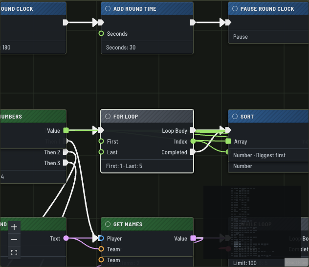
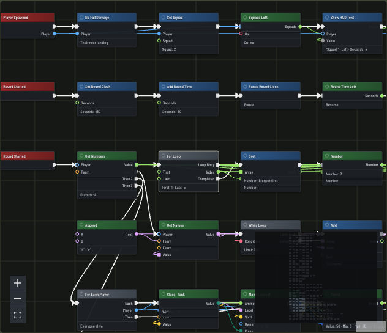

# Agent X — Game Mode Studio

Earlier rounds are in docs/TOOLS-NOTES.md ("Agent X" sections). From here on, notes go here.

## 2026-11-12, late: loose ends, Playtest feedback, crisp zoom, snippets, Blueprint-style editor

**Saved values survive a crash.** Saved values no longer use nvault (it only wrote at map end; a killed
server lost everything). Each mode has its own file, `addons/amxmodx/data/studio/<mode>.saved`
(`key<TAB>value` lines), kept in memory and written on every change, through `<mode>.saved.new`
renamed over the old file (on Windows the old one goes first; the .new one is read if a crash lands
between). Checked: the sim harness kills HLDS at the end of a run — all 6 saves were in the file; a
second run loaded them and added to them.

**Buying rules and bots: no bypass.** Live on a sim copy with `mp_startmoney 16000`: with Allow Buying
"nothing" every bot still held its spawn pistol after the buy time; the same graph with "everything"
had bots holding AK-47, M4A1, FAMAS, SG 552 and M249. So the cstrike module's `CS_OnBuyAttempt` sees the
bots' purchases too; nothing extra needed. (The "nothing" choice is labelled so: the spawn pistol stays.)

**Playtest wasn't broken, just silent.** The button works. Before, nothing showed what was happening
while it compiled (amxxpc under CrossOver, a few seconds) and while the game started (Steam, CrossOver,
the map: up to a minute the first time). Now:
- the button becomes the current step with its seconds and a Cancel: Saving, Compiling (the first
  time under CrossOver takes longer), Checking the game, Starting / Restarting / Switching the open game;
- the Playtest panel counts "Waiting for the game… N s" with what's likely going on (starting the game
  and the map; after 20 s the first-start note; after 90 s "check the game's window");
- an unchanged graph isn't compiled again (hash of the source and includes; 0 s instead of seconds);
- an open game is switched to the mode with a map change (`POST /api/tools/studio/switch`: the mode's
  plugin list and current.txt as a start writes them, then `gm_map` over the console) instead of being
  closed and started again; if that fails it offers the restart;
- a Playwright test (`tests/studio-playtest.spec.ts`) checks the button is there and enabled on a clean
  graph and that pressing it shows the steps and the wait (compile and launch answered by stubs).

**Crisp zoom (WebKit on the Mac, Chromium/WebView2 on Windows).** After a pan or zoom settles, the
view's offset is put on whole device pixels (`devicePixelRatio`, so 1.25/1.5 too: no half-pixel blur,
no 1 px jitter between pans), and on WebKit only (by user agent) the viewport is drawn again so it
doesn't keep a lower-resolution bitmap of the zoomed layer. No filters on wires (a drop-shadow on lit
wires made WebKit rasterize them), nothing uses will-change. Radar maker's PanZoom: `will-change` removed
and its offset rounded the same way (two small edits in overview/). Callouts' TopDown already draws its
canvas at the device pixel ratio; the map editor draws with three.js. Checked with Playwright WebKit
and Chromium at device pixel ratios 1, 1.25, 1.5, 2 and zoom 0.5–2 after wheel zooming: text and
borders sharp in both. The real WKWebView compositor can't be run headless, so that last step is the
user's eyes.

**Comment boxes no longer catch the canvas gestures.** Only the title bar (move, with the nodes inside)
and the resize handles take the mouse; inside, the canvas pans and box-selects as anywhere (checked in
WebKit and Chromium: a drag inside a box pans the view).

**Snippets.** 14 built-in pieces in `app/ui/src/views/tools/studio/snippets/` (made by
`scripts/make-studio-snippets.py`, laid out by `npm run tidy:studio`): wave system, countdown and start,
shop menu, revive, zone that shrinks, supply drop every minute, loadout on spawn, last squad standing,
kill reward, creatures at markers, round timer win, team score to 10, teleport on touch, chat command.
Click (into free space under the graph) or drag one in: its nodes, wires and variables are added in a
comment box named after it; variables join by name, type and scope, or get a new name on a clash. Save
the selection as your own snippet (`/api/tools/studio/snippets`, `snippet/:id`, `snippet/:id/delete`;
kept in `<app>/tools/studio/snippets/`, checked like a graph: graph data only, same text rules).
Every built-in snippet checks clean as a mode and is compiled with amxxpc in the compile test.
Spawn Creature now also takes a wired entity (creatures at every marker).

**Blueprint-style editor (UI only, the graph JSON is unchanged).**
- Left "My mode" panel: Events, Functions, Variables (+ to add; drag a variable onto the canvas for
  Get/Set), Snippets (search, click or drag; save the selection; delete your own).
- Right "Details": the selected node, variable (name, type, one for, kept, start value, used by),
  comment (colours) or the mode (name, description, game settings).
- Bottom "Results": Problems (click to go to the node) and Compiler output; above the shared ActionBar.
- Toolbar: Undo, Redo, Tidy up, Find in this mode, map, bots, Playtest. Function crumbs: looking at a
  Function adds "Function: name" to the breadcrumbs.
- Nodes coloured by kind like Blueprints (events red, values green, functions purple, flow grey, actions
  blue), flow pins white pentagons (hollow until wired), data pins coloured circles by type, wires
  solid in their type's colour (flow white and thicker), a dark grid with major lines, minimap.

**Checks:** `cargo test studio` 33 passed (incl. the amxxpc compile of every test graph, both templates
and all snippets, no warnings); `npm run test:studio` 14 passed; `npm run build` green (Studio chunk
508.6 kB, start chunk 529.45 kB); the Playtest Playwright test passes.

**For S (MCP):** new Studio routes if you wrap them: `POST /api/tools/studio/switch`,
`GET /api/tools/studio/snippets`, `POST /api/tools/studio/snippet/:id`, `POST /api/tools/studio/snippet/:id/delete`.

## 2026-11-13: graph version 3 (Blueprint staples), My library, QA fixes, a light app touch

**Graph version 3** (versions 1 and 2 open as 3; nothing new is written for them). New optional
`enums`, `structs`, `functions`, `macros`; a node or comment with `"graph": "<id>"` is on that
Function's or Macro's own graph; library marks (`from: {lib, version}`) on those four.
- **Graph tabs**: Event Graph plus a tab per open Function or Macro (double-click it in My mode or
  double-click a Call/Macro node; × or middle-click closes; drag to reorder). The address is
  `studio:<mode>/<tab>`, so Back and the crumbs (`Function: name`) step out of a tab.
- **Functions** (own graph: Function Entry with the inputs, Return Node(s) with the outputs, local
  variables reset each run, pure or with flow; Call / Call Pure nodes; Set Timer by Function).
  No Delay/Repeat/Countdown/Menu inside a Function (they'd return early): use a Macro.
  **Macros** (any number of flow and data pins, Delays allowed) are copied in where used before
  the plugin is made (`expand.rs`); the debugger shows the Macro node for its copies.
  **Collapse to Function / Macro** (right-click with a selection).
- **Types**: arrays of every type (incl. structs), maps (text/number/player keys to plain types or
  enums), structs, enums, vectors, timer handles, for variables, pins and Function members.
  Generic nodes take the type of their first wire. In the plugin: arrays are cellarray handles
  (every index clamped, at most 10000 items), maps tries, vectors and structs slots in rings (256
  vectors, 64 structs; variables have their own slots), so — like text — they don't last through a
  Delay unless kept in a variable (checked).
- **Nodes** (220 now): Sequence, Do Once, Do N, Gate, Flip Flop, For Loop (+ with Break), While
  (bounded), For Each over an array (with Break), Switch on number/text/enum, Is Valid (pure and
  branch), Is Player, Is Creature, Equal, Select, Retriggerable Delay, Clear Timer, Is Timer Active,
  Print String, Math Function / Clamp / Lerp / In Range / Number, mod and power, Text / Append /
  Format Text (`[0]`..`[3]`) / Contains / Length / To Number / To Text, Make/Break Vector, Vector
  Math, Scale, Length, Distance, Direction, Normalize, Position Of Player (feet, eyes, aim, aim
  point, velocity), Position Of Entity, Set Position, Set Velocity, Make/Break Struct, Set Field,
  Enum Value, Enum To Number, Make Array, Players Array, Add, Insert, Remove Item, Remove Index,
  Set, Clear, Shuffle, Sort, Get, Length, Contains, Find, Random Item, Map Add/Remove/Clear/Find/
  Contains/Length/Keys/Values.
- **Watch values**: hover a pin for the value the game last saw there (an output: as the nodes it
  feeds saw it).
- **Security**: every new name (enum values, fields, members, Functions, Macros) goes through the
  same allow-list; Pawn identifiers are ours (`lsg_fr0`, `lsg_mks0`, `lsg_mka12`); test
  `hostile_v3_names_stay_data`.

**My library** (user request): right-click a Function, Macro, struct or enum in My mode → Save to
my library (name, description, category). The item holds the part and everything it needs (the
structs and enums it uses, Functions and Macros it calls, mode variables it reads or sets), kept in
`<app>/tools/studio/library/<id>.lib.json` (`/api/tools/studio/library`, `library/:id`,
`library/:id/delete`), checked like a graph (graph data only; never events). Saving changed content
again bumps its version. The My library panel lists them by category with search; double-click or
drag one in: the same enum/struct (same values or fields) and variables (same name, type, scope)
are used again, anything else comes in with fresh ids and is renamed on a clash. The copy remembers
`{lib, version}`; when the library has a newer version, its Details offer "Update from library"
(asks first; replaces the graph and pins in place, keeps the name; calls stay). Export as a
`.lib.json` file, Import from files. Community sharing can reuse the same file later.
Tested: `library_items_are_checked_and_versioned` (Rust), the library test in `npm run test:studio`
(dependencies, merge, rename, update in place) and live: a mode built from a library item compiled
with amxxpc and ran with 12 bots ("helper ran" ×12, "kits given: 12").

**QA fixes** (requests below):
1. Drop Weapon: a bot's weapon is now taken away instead of `drop` (which crashes this DLL for bots;
   people still drop). Live: 17 bot drops, no crash.
2. A mode with component nodes lists `gm_components.amxx` before its plugin in its plugins.ini
   (`gen::needs`).
3. Creature types a mode spawns are precached as the map loads (`plugin_precache` adds them to
   `ls_creature_precache`; "all" when waves of components bring theirs). Live: Last Stand Lite on
   ls_outpost precached 8 types and cleared wave 1 (it stalled before); its "laststand" pack still
   isn't on ls_outpost (the components are in the BSP) and the flow carries on.
5. A breakpoint inside a loop: while the world is paused nothing else runs; what would (the loop's
   other rounds, what comes after, other events) waits in order and runs after Resume, pausing
   again at each round's breakpoint. The page keeps "Paused" until `world_resumed` and trusts the
   game's `paused` flag. Live: a breakpoint in For Each Player with 12 bots paused 12 times, each
   Resume ran the next player, then "after loop".
6. A Resume sent with a breakpoint change isn't lost: the plugin moves the command file aside
   before reading it.
7. The debugger shows the value the node uses: in debug builds each input is worked out once into
   a local.
Not done yet: 8 (zone nodes with a wired zone, Create Component for traps/extractions, In Zone on
a created zone) and 9 (the small ones).
Known limits: a breakpoint inside a Function pauses inside it, but the call's outputs were already
read (they show the last values); breakpoints inside pure Functions are best avoided.

**A light Loner-Strike touch** (user request; no change to category, pin, wire or text colours).
Two options were tried; the restrained one (A) is in:
squarer VGUI corners (4 px) and the app's bevel on nodes, a 1 px highlight along the top edge of
title bars (it sits above the text, so title contrast is unchanged: white on the title colours is
5.5–6.5:1 as before; node body text 13.8:1), a bone outline for the selection (the app's yellow now
only means running/paused), an olive tint in the grid, the app's olive as the default comment
colour, bevelled tabs. Option B added the app's bold caps for titles and a dark hatch on title bars
(contrast only goes up) and was left out as too much. Pin and wire colours are untouched, so their
colour-blind distinguishability is unchanged.

| zoom | before | A (in) | B (not taken) |
|---|---|---|---|
| 100% |  |  |  |
| 60% |  |  |  |

**Live sim run of every node** (`every_node.graph.json`, debug build, 12 bots, 150 s): Maths for a
For Loop with Break "0 2.50 0 0 / 1 3.25 1 1 / 2 4 1.41 4" (broke at 3), struct "Loadout: 40 kit
Tank 0 0 0" (clamped field, enum name, vector field), Function Reward "Said: kill!" "Total: 5"
(local reset each call) ×24, maps "12 yes 12 1", pure Function "Double: 8", Macro "gave: 6",
arrays "5 items, has 7 yes at 0", vectors per player, Players Array, switch on enum, no errors
other than the map's missing pack and teleport target.

**Checks:** `cargo test` 695 passed (studio 41, incl. amxxpc compiles of every test graph release and
debug with no warnings); `npm run test:studio` 20 passed; `npm run build` green (Studio chunk
610.5 kB, start chunk 530.75 kB); the Playtest Playwright test passes (WebKit and Chromium).

**For S (MCP):** new routes `GET /api/tools/studio/library`, `POST /api/tools/studio/library/:id`,
`POST /api/tools/studio/library/:id/delete`.

## Requests from QA (2026-11-12, real tests on sims QA4/QA5; full report docs/notes/QA.md)
1. **[Critical] Drop Weapon crashes HLDS** (bots on de_dust2, both tries; "Illegal termination of worker thread
   'CFileWriterThread'"). A bare `engclient_cmd(bot,"drop")` with no Studio mode crashes the LSPLAY brain+creatures mp.dll
   too, so the root is in the DLL (told Y), but the node should avoid it (e.g. a different drop path for bots).
2. **[High] Studio modes never load gm_components**: the installed plugin list has only the Studio plugin, so every
   component node says "gm_components isn't running"; `needs` in nodes.json isn't used by the Rust side.
3. **[High] Creature Spawn fails without Last Stand loaded** ("model isn't precached": only gm_laststand sets
   `ls_creature_precache`). Precache the creature types a graph uses.
4. **[High] Last Stand Lite stalls forever**: kills the T bots, `load_pack laststand` fails on ls_outpost (its components
   are in the BSP), no creatures, wave 1 never clears. Royale Lite stalls as installed (bug 2); with gm_components it
   plays to a winner.
5. **[High] A breakpoint inside For Each leaves the server frozen and the page can't Resume**: other iterations keep
   running and each `node_enter` clears the page's paused state (`debugState.ts`); the page ignores `world_paused` /
   `vars.paused`. Same in WebKit and Chromium.
6. **[Medium] A Resume sent together with a breakpoint change can be lost** (the .cmd file read then deleted by path);
   world stayed frozen 190 s+.
7. **[Medium] The debugger can show a different value from the one used** (inputs evaluated twice in debug builds:
   showed "Condition: True", took False with math.random).
8. **[Medium] Zone Set / Zone Shrink ignore a wired zone** ("No entity has that name"); Create Component for a trap or an
   extraction returns entity 0 with no error; In Zone on a created zone throws AMXX run-time error 10 in
   `ls_zone_inside` (W1 native) and ends the flow.
9. **[Low] Player Hurt fires for blocked damage** with the original amount; ls_outpost's component names have spaces that
   Find Component refuses; Creature Count reads 0 right after a spawn; Team Changed fires 3× per join (first "none");
   an entity sent to a HUD node shows empty; uninstall leaves the .sma/.amxx/.hash/.bp/.cmd; `npm run test:studio` 2 of
   14 fail on the current tree (`timer.delay.handle` registry check, template layout).
Passed for real: every player node, readouts, damage scale/set/block, down/revive, squads, buying rules incl. bots,
saved values across kill -9, round clock, variables/maths/flow/timers/functions, events, chat command, compile/install/
uninstall routes, server-side breakpoint pause/resume, the Playtest button test (both engines).
