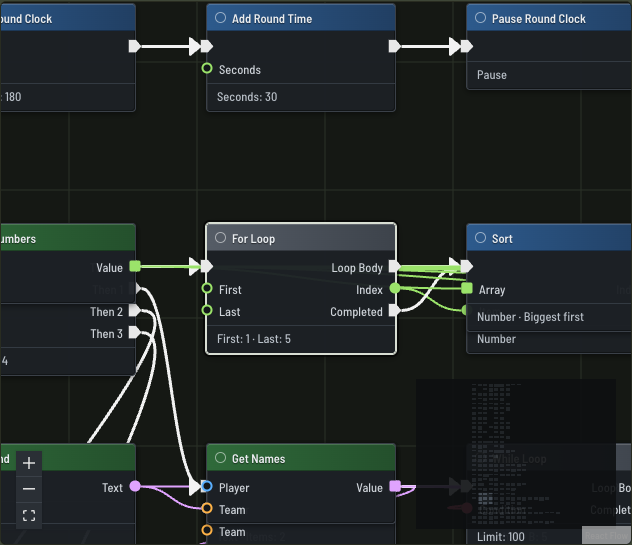
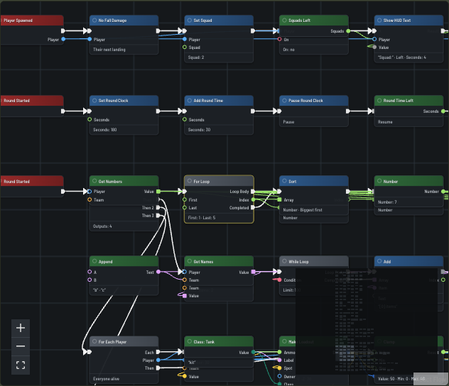

# Agent X — Game Mode Studio

Earlier rounds are in docs/TOOLS-NOTES.md ("Agent X" sections). From here on, notes go here.

## From Parity A: QA4 area B self-check (2026-11-14)
Table in QA4.md (area B self-check). Nothing big failed: the five examples compile, test-run to pass and play on a
sim without run-time errors; Playtest, the debugger (breakpoint, variables, a live tweak, Resume), Timelines in real
time with Reverse, data tables, custom events with an input, Set Timer by Event, tab order, mode settings (local),
Requirements, the creature and bot nodes, the security allowlist and the publish package's capabilities all did what
their help says. For you, small:
- Specs (your files, in your working tree now): `studio-playtest.spec.ts:15` finds two `role=status` "Compiling"
  (strict mode) and `studio-v3.spec.ts:160` imports to "pw_one_2" on a fresh app folder (large project, first run).
- A deliberate run-time error couldn't be made from any graph (good); the Test run row "fail with the error on its
  node" can only be seen with a hand-made plugin now. The old Set Zone error 10 is a warn with both problems on nodes.
- After Resume from a breakpoint in a Repeat timer's tick, the next tick came 0.2 s later instead of 2 s (the pause
  didn't hold the timer; harmless).
- `world.spawn_prop` isn't a node type (the publish check said "This app doesn't know the node"): my graph's mistake,
  but the Requirements scan still found its model in the params, which is right.

## From Parity A: regression sweep failures (2026-11-14)
Clean worktree at `tools` ced20c90 (Parity A, regression sweep 2026-11-14): every spec in the repo's Chromium
projects (large 1440x900, small 1024x680) and WebKit, one worker, against the tools dev server; each failure run
again. Repeatable failures for you:
- `studio-v3.spec.ts:550` "several event graphs" (WebKit only, twice): after "Add graph" with the name "Shop" the
  selected tab is still " Event Graph" (line 564). Chromium passes.
Flaky (failed once, passed on the rerun): `studio-v3.spec.ts:153` library Export/Import (got "pw_one_2": a "pw_one"
left from an earlier run in the same app folder), `studio-help.spec.ts:91` (WebKit), `studio-playtest.spec.ts:15`
(small and WebKit: two `role=status` elements with "Compiling" at once, a strict-mode violation).
Not failures (the sweep's setup): `studio-perf.spec.ts:55` and `studio-v3.spec.ts:325` read
`../src-tauri/.../every_node.graph.json` relative to the working folder, so they only pass when run from app/ui.

## 2026-11-12, late: loose ends, Playtest feedback, crisp zoom, snippets, Blueprint-style editor

**Saved values survive a crash.** Saved values no longer use nvault (it only wrote at map end; a killed
server lost everything). Each mode has its own file, `addons/amxmodx/data/studio/<mode>.saved`
(`key<TAB>value` lines), kept in memory and written on every change, through `<mode>.saved.new`
renamed over the old file (on Windows the old one goes first; the .new one is read if a crash lands
between). Checked: the sim harness kills HLDS at the end of a run — all 6 saves were in the file; a
second run loaded them and added to them.

**Buying rules and bots: no bypass.** Live on a sim copy with `mp_startmoney 16000`: with Allow Buying
"nothing" every bot still held its spawn pistol after the buy time; the same graph with "everything"
had bots holding AK-47, M4A1, FAMAS, SG 552 and M249. So the cstrike module's `CS_OnBuyAttempt` sees the
bots' purchases too; nothing extra needed. (The "nothing" choice is labelled so: the spawn pistol stays.)

**Playtest wasn't broken, just silent.** The button works. Before, nothing showed what was happening
while it compiled (amxxpc under CrossOver, a few seconds) and while the game started (Steam, CrossOver,
the map: up to a minute the first time). Now:
- the button becomes the current step with its seconds and a Cancel: Saving, Compiling (the first
  time under CrossOver takes longer), Checking the game, Starting / Restarting / Switching the open game;
- the Playtest panel counts "Waiting for the game… N s" with what's likely going on (starting the game
  and the map; after 20 s the first-start note; after 90 s "check the game's window");
- an unchanged graph isn't compiled again (hash of the source and includes; 0 s instead of seconds);
- an open game is switched to the mode with a map change (`POST /api/tools/studio/switch`: the mode's
  plugin list and current.txt as a start writes them, then `gm_map` over the console) instead of being
  closed and started again; if that fails it offers the restart;
- a Playwright test (`tests/studio-playtest.spec.ts`) checks the button is there and enabled on a clean
  graph and that pressing it shows the steps and the wait (compile and launch answered by stubs).

**Crisp zoom (WebKit on the Mac, Chromium/WebView2 on Windows).** After a pan or zoom settles, the
view's offset is put on whole device pixels (`devicePixelRatio`, so 1.25/1.5 too: no half-pixel blur,
no 1 px jitter between pans), and on WebKit only (by user agent) the viewport is drawn again so it
doesn't keep a lower-resolution bitmap of the zoomed layer. No filters on wires (a drop-shadow on lit
wires made WebKit rasterize them), nothing uses will-change. Radar maker's PanZoom: `will-change` removed
and its offset rounded the same way (two small edits in overview/). Callouts' TopDown already draws its
canvas at the device pixel ratio; the map editor draws with three.js. Checked with Playwright WebKit
and Chromium at device pixel ratios 1, 1.25, 1.5, 2 and zoom 0.5–2 after wheel zooming: text and
borders sharp in both. The real WKWebView compositor can't be run headless, so that last step is the
user's eyes.

**Comment boxes no longer catch the canvas gestures.** Only the title bar (move, with the nodes inside)
and the resize handles take the mouse; inside, the canvas pans and box-selects as anywhere (checked in
WebKit and Chromium: a drag inside a box pans the view).

**Snippets.** 14 built-in pieces in `app/ui/src/views/tools/studio/snippets/` (made by
`scripts/make-studio-snippets.py`, laid out by `npm run tidy:studio`): wave system, countdown and start,
shop menu, revive, zone that shrinks, supply drop every minute, loadout on spawn, last squad standing,
kill reward, creatures at markers, round timer win, team score to 10, teleport on touch, chat command.
Click (into free space under the graph) or drag one in: its nodes, wires and variables are added in a
comment box named after it; variables join by name, type and scope, or get a new name on a clash. Save
the selection as your own snippet (`/api/tools/studio/snippets`, `snippet/:id`, `snippet/:id/delete`;
kept in `<app>/tools/studio/snippets/`, checked like a graph: graph data only, same text rules).
Every built-in snippet checks clean as a mode and is compiled with amxxpc in the compile test.
Spawn Creature now also takes a wired entity (creatures at every marker).

**Blueprint-style editor (UI only, the graph JSON is unchanged).**
- Left "My mode" panel: Events, Functions, Variables (+ to add; drag a variable onto the canvas for
  Get/Set), Snippets (search, click or drag; save the selection; delete your own).
- Right "Details": the selected node, variable (name, type, one for, kept, start value, used by),
  comment (colours) or the mode (name, description, game settings).
- Bottom "Results": Problems (click to go to the node) and Compiler output; above the shared ActionBar.
- Toolbar: Undo, Redo, Tidy up, Find in this mode, map, bots, Playtest. Function crumbs: looking at a
  Function adds "Function: name" to the breadcrumbs.
- Nodes coloured by kind like Blueprints (events red, values green, functions purple, flow grey, actions
  blue), flow pins white pentagons (hollow until wired), data pins coloured circles by type, wires
  solid in their type's colour (flow white and thicker), a dark grid with major lines, minimap.

**Checks:** `cargo test studio` 33 passed (incl. the amxxpc compile of every test graph, both templates
and all snippets, no warnings); `npm run test:studio` 14 passed; `npm run build` green (Studio chunk
508.6 kB, start chunk 529.45 kB); the Playtest Playwright test passes.

**For S (MCP):** new Studio routes if you wrap them: `POST /api/tools/studio/switch`,
`GET /api/tools/studio/snippets`, `POST /api/tools/studio/snippet/:id`, `POST /api/tools/studio/snippet/:id/delete`.

## 2026-11-13: graph version 3 (Blueprint staples), My library, QA fixes, a light app touch

**Graph version 3** (versions 1 and 2 open as 3; nothing new is written for them). New optional
`enums`, `structs`, `functions`, `macros`; a node or comment with `"graph": "<id>"` is on that
Function's or Macro's own graph; library marks (`from: {lib, version}`) on those four.
- **Graph tabs**: Event Graph plus a tab per open Function or Macro (double-click it in My mode or
  double-click a Call/Macro node; × or middle-click closes; drag to reorder). The address is
  `studio:<mode>/<tab>`, so Back and the crumbs (`Function: name`) step out of a tab.
- **Functions** (own graph: Function Entry with the inputs, Return Node(s) with the outputs, local
  variables reset each run, pure or with flow; Call / Call Pure nodes; Set Timer by Function).
  No Delay/Repeat/Countdown/Menu inside a Function (they'd return early): use a Macro.
  **Macros** (any number of flow and data pins, Delays allowed) are copied in where used before
  the plugin is made (`expand.rs`); the debugger shows the Macro node for its copies.
  **Collapse to Function / Macro** (right-click with a selection).
- **Types**: arrays of every type (incl. structs), maps (text/number/player keys to plain types or
  enums), structs, enums, vectors, timer handles, for variables, pins and Function members.
  Generic nodes take the type of their first wire. In the plugin: arrays are cellarray handles
  (every index clamped, at most 10000 items), maps tries, vectors and structs slots in rings (256
  vectors, 64 structs; variables have their own slots), so — like text — they don't last through a
  Delay unless kept in a variable (checked).
- **Nodes** (220 now): Sequence, Do Once, Do N, Gate, Flip Flop, For Loop (+ with Break), While
  (bounded), For Each over an array (with Break), Switch on number/text/enum, Is Valid (pure and
  branch), Is Player, Is Creature, Equal, Select, Retriggerable Delay, Clear Timer, Is Timer Active,
  Print String, Math Function / Clamp / Lerp / In Range / Number, mod and power, Text / Append /
  Format Text (`[0]`..`[3]`) / Contains / Length / To Number / To Text, Make/Break Vector, Vector
  Math, Scale, Length, Distance, Direction, Normalize, Position Of Player (feet, eyes, aim, aim
  point, velocity), Position Of Entity, Set Position, Set Velocity, Make/Break Struct, Set Field,
  Enum Value, Enum To Number, Make Array, Players Array, Add, Insert, Remove Item, Remove Index,
  Set, Clear, Shuffle, Sort, Get, Length, Contains, Find, Random Item, Map Add/Remove/Clear/Find/
  Contains/Length/Keys/Values.
- **Watch values**: hover a pin for the value the game last saw there (an output: as the nodes it
  feeds saw it).
- **Security**: every new name (enum values, fields, members, Functions, Macros) goes through the
  same allow-list; Pawn identifiers are ours (`lsg_fr0`, `lsg_mks0`, `lsg_mka12`); test
  `hostile_v3_names_stay_data`.

**My library** (user request): right-click a Function, Macro, struct or enum in My mode → Save to
my library (name, description, category). The item holds the part and everything it needs (the
structs and enums it uses, Functions and Macros it calls, mode variables it reads or sets), kept in
`<app>/tools/studio/library/<id>.lib.json` (`/api/tools/studio/library`, `library/:id`,
`library/:id/delete`), checked like a graph (graph data only; never events). Saving changed content
again bumps its version. The My library panel lists them by category with search; double-click or
drag one in: the same enum/struct (same values or fields) and variables (same name, type, scope)
are used again, anything else comes in with fresh ids and is renamed on a clash. The copy remembers
`{lib, version}`; when the library has a newer version, its Details offer "Update from library"
(asks first; replaces the graph and pins in place, keeps the name; calls stay). Export as a
`.lib.json` file, Import from files. Community sharing can reuse the same file later.
Tested: `library_items_are_checked_and_versioned` (Rust), the library test in `npm run test:studio`
(dependencies, merge, rename, update in place) and live: a mode built from a library item compiled
with amxxpc and ran with 12 bots ("helper ran" ×12, "kits given: 12").

**QA fixes** (requests below):
1. Drop Weapon: a bot's weapon is now taken away instead of `drop` (which crashes this DLL for bots;
   people still drop). Live: 17 bot drops, no crash.
2. A mode with component nodes lists `gm_components.amxx` before its plugin in its plugins.ini
   (`gen::needs`).
3. Creature types a mode spawns are precached as the map loads (`plugin_precache` adds them to
   `ls_creature_precache`; "all" when waves of components bring theirs). Live: Last Stand Lite on
   ls_outpost precached 8 types and cleared wave 1 (it stalled before); its "laststand" pack still
   isn't on ls_outpost (the components are in the BSP) and the flow carries on.
5. A breakpoint inside a loop: while the world is paused nothing else runs; what would (the loop's
   other rounds, what comes after, other events) waits in order and runs after Resume, pausing
   again at each round's breakpoint. The page keeps "Paused" until `world_resumed` and trusts the
   game's `paused` flag. Live: a breakpoint in For Each Player with 12 bots paused 12 times, each
   Resume ran the next player, then "after loop".
6. A Resume sent with a breakpoint change isn't lost: the plugin moves the command file aside
   before reading it.
7. The debugger shows the value the node uses: in debug builds each input is worked out once into
   a local.
8 and 9: see "2026-11-13, later" below.
Known limits: a breakpoint inside a Function pauses inside it, but the call's outputs were already
read (they show the last values); breakpoints inside pure Functions are best avoided.

**A light Loner-Strike touch** (user request; no change to category, pin, wire or text colours).
Two options were tried; the restrained one (A) is in:
squarer VGUI corners (4 px) and the app's bevel on nodes, a 1 px highlight along the top edge of
title bars (it sits above the text, so title contrast is unchanged: white on the title colours is
5.5–6.5:1 as before; node body text 13.8:1), a bone outline for the selection (the app's yellow now
only means running/paused), an olive tint in the grid, the app's olive as the default comment
colour, bevelled tabs. Option B added the app's bold caps for titles and a dark hatch on title bars
(contrast only goes up) and was left out as too much. Pin and wire colours are untouched, so their
colour-blind distinguishability is unchanged.

| zoom | before | A (in) | B (not taken) |
|---|---|---|---|
| 100% |  |  |  |
| 60% |  |  |  |

**Live sim run of every node** (`every_node.graph.json`, debug build, 12 bots, 150 s): Maths for a
For Loop with Break "0 2.50 0 0 / 1 3.25 1 1 / 2 4 1.41 4" (broke at 3), struct "Loadout: 40 kit
Tank 0 0 0" (clamped field, enum name, vector field), Function Reward "Said: kill!" "Total: 5"
(local reset each call) ×24, maps "12 yes 12 1", pure Function "Double: 8", Macro "gave: 6",
arrays "5 items, has 7 yes at 0", vectors per player, Players Array, switch on enum, no errors
other than the map's missing pack and teleport target.

**Checks:** `cargo test` 695 passed (studio 41, incl. amxxpc compiles of every test graph release and
debug with no warnings); `npm run test:studio` 20 passed; `npm run build` green (Studio chunk
610.5 kB, start chunk 530.75 kB); the Playtest Playwright test passes (WebKit and Chromium).

**For S (MCP):** new routes `GET /api/tools/studio/library`, `POST /api/tools/studio/library/:id`,
`POST /api/tools/studio/library/:id/delete`.

## Mode map kit format (version 1, 2026-11-13)
A **mode map kit** says what a map needs for one game mode, so anyone can make a map for it in the map
editor. It's data only (JSON, no code). One file per mode: `<mode id>.kit.json`.

**Where kits live:** the app's kits folder, `<app dir>/kits/<mode id>.kit.json`. The Studio writes one
for each Studio mode (generated from the graph, saved next to it as `<graphs>/<id>.kit.json`) and copies it
into the kits folder when the mode is installed (Install / Playtest / a community mode). Hand-written
modes (Last Stand, Battle Royale) ship a hand-written kit in `plugins/game/kits/<id>.kit.json`
(setup copies them the same way). Community mode packages carry the kit beside the graph.

```json
{
  "schema": "loner-strike/mode-kit",
  "version": 1,
  "mode": { "uid": "7309d9f8-7f61-4c15-ad16-4f5260cb9787", "id": "laststand", "name": "Last Stand", "description": "Hold the base against waves" },
  "source": "studio",
  "markers": [
    {
      "id": "creature_spawn",
      "label": "Creature spawn",
      "description": "Where creatures come in. Put them out of sight of the base.",
      "type": "point",
      "required": { "min": 2, "max": 32 },
      "keys": [
        { "name": "wave", "type": "number", "default": 1, "help": "First wave that uses it", "min": 1, "max": 99 },
        { "name": "side", "type": "choice", "default": "north", "help": "Which gate", "choices": [["north", "North"], ["south", "South"]] }
      ],
      "draw": { "colour": "#c0392b", "icon": "skull", "shape": "diamond" }
    }
  ],
  "components": [ { "classname": "ls_wave_spawner", "min": 1, "max": 1, "note": "One wave spawner" } ],
  "creatures": [ "zombie", "brute" ],
  "map": { "size": "medium", "players": { "min": 2, "max": 16 } },
  "notes": "Free text for map makers (up to 600 letters)."
}
```

| field | rules |
|---|---|
| `schema`, `version` | `"loner-strike/mode-kit"`, `1`. A reader refuses other schemas and newer versions it doesn't know. |
| `mode` | `id`: the mode's real id, as modes.ini, the Play page and Playtest use it (`laststand`, `br`; a Studio mode: its graph's mode id); 2–24 of `a-z 0-9 _`, starting with a letter. `name` ≤ 40, `description` ≤ 60 (plain text). |
| `mode.uid` | required: the mode's permanent identity, a UUID v4 (lower case). Made once when the mode is made; a rename or a new short id never changes it. Match modes by uid; show and file by `id`. |
| `source` | `"studio"` (generated from a graph: don't edit by hand) or `"hand"`. |
| `markers[]` | ≤ 32. `id`: 1–24 of `a-z 0-9 _`, unique in the kit. `label` ≤ 30, `description` ≤ 200. |
| `type` | `point` (one spot), `area` (a spot with a `size "x y z"` box or a `radius` round it), `path` (spots in order: 2 or more per path). |
| `required` | `min` 0–64 (0 = optional), `max` 1–64 and ≥ min, or `null` (no limit). For a path: how many paths. |
| `keys[]` | ≤ 8 per marker. `name`: 1–24 of `a-z 0-9 _`, not one of the reserved keys (`classname origin angles model targetname target mode kind order path size radius spawnflags`). `type`: `number` (with optional `min`/`max`), `text` (≤ 60), `bool` (0/1 in the map), `choice` (`choices`: [value, label] pairs, ≤ 16, values like names). `default` fits the type. `help` ≤ 120. |
| `draw` | how editors show it: `colour` `#rrggbb`; `icon` one of `flag skull star crate door person arrow circle bolt heart`; `shape` one of `diamond box sphere cylinder line` (defaults: point diamond, area box, path line). An area also has `size` `[x, y, z]` or `radius` (the default the editor puts on a new one). |
| `components[]` | `ls_*` classnames (gm_components' kinds) the map must have, `min`/`max` as above, `note` ≤ 120. Placed as the component entity itself or as an `ls_marker` with `kind` = the classname (W1). Components the mode makes itself at run time aren't listed. |
| `creatures[]` | creature type names the mode spawns (the map needs room/nav for them; nothing to place). |
| `map` | optional: `size` `small` (≤ 2048 across), `medium` (≤ 4096), `large`; `players` `{min, max}` 1–32. |
| `notes` | ≤ 600, plain text. |

**Mode identity (uid), 2026-11-13.** Every mode has a permanent `uid` (UUID v4) beside its short `id`
(the game id: modes.ini, the cfg and plugin file names, `ls_marker`'s `mode`, Playtest).
- Built-in modes' fixed uids: **Last Stand (`laststand`) `7309d9f8-7f61-4c15-ad16-4f5260cb9787`**,
  **Battle Royale (`br`) `b972ea10-43af-42cb-81f0-79e493a87a11`**. Put them in their kits (W1).
- Studio graphs: `mode.uid` is made when the mode is made (new or from a template: a template's copy
  gets a new one); a graph from before uids gets one the first time it's opened (saved back). A rename
  keeps it.
- Installing a Studio mode: if its uid is installed already, it goes there (whatever short id that is);
  else under its own id, unless another mode has that id (one not made in the Studio, or another uid):
  then the first free `<id>_2`, `<id>_3`… The compile/Playtest answer says `installedAs`. The uid is
  written in `<id>.plugins.ini`'s first line (`; Made with the Game Mode Studio (uid …): …`); a Studio
  install from before uids counts as the same mode. The kit goes in the kits folder under the installed id.
- Library items and snippets carry `fromMode` (the uid of the mode they came from). A remix gets a new
  uid and `remixOf` = the original's uid (T).

**In the map** (W1's `ls_marker`, adopted): every marker is a point entity of class **`ls_marker`** with
- `kind` = the marker id (or an `ls_*` component classname: gm_components turns it into that component),
- `mode` = the mode id (the modes.ini id: `laststand`, `br`, a Studio mode's id), a comma list of them, or `any` / empty / left out (any mode with a marker of that id),
- an area: `size "x y z"` (a box round the origin) or `radius`; a path: one `ls_marker` per spot with
  `order` 1, 2, 3… (several paths of one marker: `path` 1, 2…); optional `targetname`, `angle`;
- the marker's own keys (missing → the kit's default).

**At run time** gm_components keeps the `ls_marker`s (not drawn, not solid) and answers
`ls_marker_find(const kind[], start = 0)` (next matching entity after `start`, 0 when none) and
`ls_marker_get(ent, const key[], out[], len)`. A Studio mode reads its markers itself (FM_KeyValue and
FM_Spawn in its plugin's plugin_precache, the same rules: `kind`, `mode` incl. comma lists and `any`,
`path`/`order`), so it needs no gm_components and gives the same answers with it loaded.

**Differences from W1's proposal (for W1):**
1. The kit calls the marker's shape `type` (point / area / path); the map key `kind` is the marker id, as
   you have it.
2. Paths: please pass `path` and `order` through like other keys (the Studio sorts by them).
3. Please resolve markers when the map loads (by plugin_cfg), not only at round start, so a mode's
   Map Started event can find them; and have `ls_marker_find` skip markers whose `mode` is another mode's
   (match the running mode id, `any` or empty).
4. Areas: `size` and `radius` as you proposed (no brush entities), so the editor draws them from keys.
5. Please add `ls_marker_mode(ent, out[], len)` only if you need it; the Studio doesn't.

**Checks** (the editor's map check, the Studio's Playtest): each marker's count within `required`, each
component's count, path markers with 2+ points and no repeated `order`, keys of the right type.

## Where X is (2026-11-13, paused for the usage limit)
**Done and committed (this commit):** the security fix for Kick and the console commands; the core
nodes batch below (Rust studio tests green with every_node_3 in coverage and amxxpc with no warnings;
UI unit tests and studio-v3/studio-playtest specs green; not yet run on a sim); and the **Compile button**:
- `POST /api/tools/studio/check` (`studio::check_compile`): the real amxxpc in
  `scripting/studio/check/`, never `plugins/` or the configs, so nothing is installed or started; the
  last answer is kept per source hash (an unchanged mode answers at once). Returns the quick check's
  `problems` and the compiler's own as `compiler` (each tied to its node by the generated spans, or
  "line N of the plugin, not tied to a node; Show code in the menu shows that line").
- Toolbar: Compile (Mod+B or F7; "Compiling…" with a spinner), a status icon (gray needs compiling /
  edited since, green compiled, yellow warnings, red errors; hover says which; click opens Problems),
  "Compile on save" (on by default, in the background, only when the quick check has no errors).
  An edit means anything but positions (`checkKey`).
- Problems: the status line "Quick check: ... (updated as you edit). Full check: ...", each item says
  "Quick check" or "Full check" (full-check items from before the latest edits are dimmed).
- The minimap hides on short/narrow windows (it covered nodes at 1024x680).
- Search finds nodes by `keywords`/`cvar`; ties keep the registry's order (Give Weapon before Give
  Ammo). New param kind `path` (models/sounds: letters, digits, `_ - . /`, up to 64, no `..`).
- Event values per flow raised 4 -> 8 (`CTX`): Player Killed now carries 7.
**Checked for real (2026-11-14):**
- Compile's real path on a sim copy through the dev server (`LS_TEST_GAME=<sim copy>`; Compile now
  finds the compiler for a folder that isn't the player's install, `studio::compiler_install`): Rifle
  Reward and Last Stand compiled in 1.8 s / 1.4 s, nothing installed (plugins and modes.ini the same
  as the base), the icon green with "Full check: compiled, no problems"; a graph with a quick-check
  error: "Fix the quick check's errors first", the icon stays gray, clicking the problem focuses the
  node. Compiler errors with the real amxxpc map to their node or say "not tied to a node" (test in
  `generated_plugins_compile_with_amxxpc`). The real app runs the same code with the player's install.
- In game (sim copy XS, 6 bots, two runs): commands read at run time from cvars set by a test plugin,
  so they reach the plugin's own check: `"exec" lscanary.cfg`, `"rcon_password" hacked`,
  `amx_cvar sv_gravity 222` on the server path, `mp_logfile 1`, `sv_gravity 1;exec lscanary.cfg`,
  `exec:lscanary.cfg`, `bot_nav_save`; AMX: `amx_cvar rcon_password hacked`, `"amx_rcon" exec ...`,
  `amx_restrict save`, a 63-letter second word: every one refused with the node's error. Kick with
  the reason `x;sv_gravity 123;exec lscanary.cfg` kicked the bot and nothing else ran; Change Map to
  `de_nothere` stayed on de_dust2; allowed `sv_gravity 300` and `amx_cvar sv_gravity 500` ran
  (gravity 500); the canary cfg (gravity 111) never ran, rcon_password unchanged, de_dust2.nav untouched.
**Test run: done (2026-11-14).** `studio/testrun.rs`; routes `POST/GET /api/tools/studio/testrun`,
`POST .../testrun/cancel`; MCP `studio_test_run` (Risky: asks, then waits for the result).
- A hidden server of its own (`<servers root>/.studio-test`, beside the simulator's `.health-check`):
  a copy of one of the player's servers (`health::sources` + `sync_copy`), else one set up from the
  game (`servers::start_hidden_server`), as the Map simulator does; no check for an open game (it
  doesn't touch it); two stock maps with navs copied in; our hlds stopped by its folder's name.
- The run (about 2 min): debug build without breakpoints (`debug` flag on the plugin line), 20 s
  baseline in Classic sampling `stats`, the mode by a changelevel, 45 s, `sv_restartround`, 15 s,
  `changelevel` to the second map, 20 s; then `amxx plugins`, the AMXX logs, the console, `ls_crash*`
  and the debugger's events (kept across the map change: the log starts again per map).
- Verdict: fail on a plugin that didn't load, run-time errors (AMXX debug trace line -> node via the
  spans), a crash or a failed compile; warn on the nodes' own errors (a refused command, "Not given"),
  heavy cost (CPU +25 points or frames under 70% of the baseline, or over 1500 node runs a second), or
  bots that didn't join; "N of M nodes never ran" as information.
- UI: Test run button and a status ("Tested ✓ 2 min ago", "(edited since)"), a Results tab with the
  steps and seconds counting, Cancel, the verdict and summary, problems that focus their node, the
  nodes that never ran, cost, Copy the log, the steps folded away after.
- Checked for real: Rifle Reward under the dev server with the real game read-only
  (`LS_SERVERS_DIR` = a sim folder, `LS_TEST_RUN_SOURCE` = sim copy B): passed, kills and the
  rifle given seen, 82 -> 92 fps / 30 -> 22% CPU, 2 of 7 nodes never ran (the T side's), about 2 min;
  from the page too. Test seam: `LS_TEST_RUN_SOURCE` (a server folder to copy when the app lists none).
- Asked of others: health.rs (`sources`, `game_folder`, `nav_files`, `sync_copy`, `spawn`,
  `free_port`, `tail` made `pub(crate)` for this; nothing else changed there); MCP: the new tool and
  its routes are listed (`routes.rs`, `more.rs`). On this Mac a test run is one more hidden server:
  count it toward the crew's sim limit.
**All Actions palette: done (2026-11-14).** `Palette.tsx`: category folders (closed until opened;
open by themselves while searching, for a short list, or from the sidebar's + buttons), big categories
split into Events / Values / Actions, search over titles, help, keywords and cvars, Favorites (star on
hover; kept in this browser) and Recently used (last 10) at the top, Context Sensitive on a dropped
wire (on by default; off lists everything), keys: Up/Down, Right/Left open/close a folder, Enter places
or toggles, Escape closes. Found on the way: a wire dropped on empty space opened the palette and the
same release's pane click closed it again (Chromium); fixed in `Canvas.tsx`.
**Several event graphs: done (2026-11-14).** For X2 (schema change): a graph may have
`eventGraphs: [{id, name}]` (at most 16; ids share the space of Function/Macro ids); a node's or
comment's `graph` may name one. Rust: `graph::EventGraph`, `graph::flatten` folds them into the first
before checking and generating (events in tab order, then top to bottom); `validate` refuses wires
between graphs and warns "Round Started is on Event Graph, Rounds: they all run, in that order" when a
built-in event (one without settings) is on more than one. UI: `isEventGraph`, `addEventGraph`,
`renameEventGraph`, `removeEventGraph` (nodes move to the Event Graph) in `graphOps.ts`; tabs after
"Event Graph" (always shown, not closable); My mode "Graphs" section (+, right-click Rename/Delete);
the palette offers events on any event graph; snippets with events go onto the open event graph;
addresses `studio:<mode>/<graph id>` open them.
**Split (2026-11-14):** X2 owns the sim tests of the new nodes, the five example modes, node help and
the Studio tour. X keeps event graphs (done), custom events with Set Timer by Event and `ls_event`,
and Timelines; X writes here when each lands so the example modes can use them.
**Custom events: done (2026-11-14).** For X2 (schema and nodes): `customEvents: [{id, name (26), inputs:
[member] (at most 8), map?: bool}]` (at most 32; ids share the Function/Macro space). Nodes `event.custom`
"Custom Event" (param `event`, kind `cevent`; outputs = its inputs; any event graph; several for one event run
in the graphs' order), `event.call` "Call Custom Event" (inputs = its inputs; anywhere, Functions too),
`timer.by_event` "Set Timer by Event" (only an event without inputs; handle for Clear Timer). Plugin:
`lsg_ce<i>(inputs)` per event. The map: with "The map can fire it", an `ls_event` entity (key `event` = its map
name, keys `a`/`b` for the first two number/text/yes-no inputs; made info_target as it loads) or an
`info_target` named `lsev_<map name>` (also one made while playing), when used; Player = who set it off. Map
name: the name in small letters with _ ("Gate Opened" -> gate_opened). UI: My mode "Custom events" (+, details
with name, inputs, "The map can fire it" and the map name), the node search lists "Custom Event: X", "Call X",
"Set Timer by X". Sim (XE, 6 bots): Delay -> Call with the round number and a text arrived (1, "from call");
an `lsev_gate_opened` info_target used by a bot (a test plugin, ExecuteHamB Ham_Use) arrived with that bot as
Player; Set Timer by Event looped every 4 s; amxxpc no warnings. Not yet seen in game: an `ls_event` placed
in a map (needs a map with one; W2's FGD line is asked above).
**X2's gen.rs fixes (Player Hurt weapon/hit group, hook order) went in with this commit**, with the snapshots, as
X2 asked; `make_nodes.py` now runs `node_help.write` (skipped while node_help.py isn't there). X2: the three new
nodes have generated help only; write theirs when you get to it. `mod.rs`'s `mod help_tests;` is yours to commit.
**Timelines: done (2026-11-14).** For X2 (schema and node): `timelines: [{id, name, length (0.1-600 s), loop?,
autoplay?, useLastKey?, tick (0.02-0.5, default 0.05), tracks: [{id, name, kind: float|vector|color|event,
keys: [{t, v (number | [x,y,z] | [r,g,b] 0-255), ease?: "ease"}]}]}]` (16 timelines, 8 tracks, 64 keys).
Node `timeline.play` "Timeline" (param `timeline`, kind `tline`): flow inputs Play, Play from Start, Stop,
Reverse, Reverse from End, Set New Time (+ New Time); outputs Update (each tick), Finished, Forward, Time,
and one per track (number; vector for position and color; a flow output per event track). Plugin: per node
and instance (the one, or each player in a Function with a Player input) a task every `tick`, values worked
out with the same straight/eased lines as the editor, event keys fired when the playhead crosses them (both
ways, around the end when Looping), Finished at the end; AutoPlay starts at each round's start; ticks hold
while the debugger pauses. Flow from a Timeline's outputs back into it (Finished -> Reverse from End, a
ping-pong) isn't a loop. Editor: a tab (double-click the node, or My mode "Timelines"): Length, Loop,
AutoPlay, Use Last Keyframe, Tick; + Number/Position/Color/Event track; click a lane adds a key, drag moves
it (Shift: one axis), Delete removes it, right-click Linear/Ease, wheel zooms, drag pans, F or Fit; the
selected key's time/value/color/ease in a bar. Sim (XT, 6 bots): a C4 prop at a spawn on a 3 s eased
position track rose 192 -> 392 (259 Set Position runs over the test), the countdown track fired at 0.5,
1.5, 2.5 s, Finished printed the color (0 0 255), then Reverse from End played it back (events at 2.4, 1.4,
0.4; color 255 0 0); amxxpc no warnings. Not done: the node's watch values (time, track values) in the
debugger, and a cost hint for many per-player instances.
**X's Blueprint parity batch 2 is complete** (palette, event graphs, custom events, timelines). X2: the
example modes can use custom events (a map's `lsev_<name>` info_target, a timer) and Timelines (a moving
platform, a pulsing glow, a countdown).
(sim tests of the core nodes, example modes, node help and the tour: X2).
**The core nodes batch:**
- registry (`make_nodes.py` → `nodes.json`, 413 nodes): Game (Current Map Name, Next Map, Server Name, Max
  Players, Player Count, Game Time, Real Date and Time, Current Mode, Round Number, Team Score, Is Freeze
  Time, Get Setting, Change Map, Restart Round), World (17 named get/set pairs: gravity, friction, max speed,
  round/freeze/buy time, friendly fire, team balance/limit, start money, C4 timer, fall damage, footsteps,
  alltalk, time/win/frag limit), Players (Armor Of, Has Helmet, Weapon Held, Ammo Of, Has Weapon, Is Admin,
  Is VIP, Ping, Steam ID, Is Spectator, Time Connected, By Name/Index, Gravity/Speed/Model Of, Get/Set
  Transform, Set Rotation, Look At, Slap, Screen Fade, Screen Shake, God Mode, No Clip, Set Visibility, Set/
  Give Ammo, Remove Weapon, Switch To Weapon, Set Kills/Deaths, Move To Spectators, Kick, Mute Voice, Gag
  Chat), Messages (Chat To Team, Notify Admins), Entities (Class/Name Of, Find Entities, Spawn Prop, Remove,
  Set Position/Rotation/Visibility), Effects (Explosion, Beam, Play Sound At/To Player, Set Light Style),
  Advanced (Run Server Command, Run AMX Command, Call Plugin Function, Plugin Is Running, Fire Custom Event,
  On Custom Event), events (Player Said, Freeze Time Ended, Map Ending, Weapon Fired (throttled),
  Reloaded, Hostage Rescued, VIP Escaped) and richer Player Killed (weapon, distance, team kill, suicide,
  by the world), Player Hurt (headshot, health left, hit group, weapon), Chat Command (arguments), Round
  Ended (round number). Search words (`keywords`) on the defs.
- codegen (`gen.rs` arms, the HELPERS stocks, `v3_helpers.pawn` vector stocks, hooks/precaches),
  `graph.rs` (`cmd_refused`, `capabilities`, advanced-node checks), kit `capabilities`, the third test
  graph (`testdata/make_every_node_3.py`, 112 kinds).
**Next, in order:**
1. Build: `cargo test studio` with `UPDATE_SNAPSHOTS=1`, add every_node_3 to the coverage test and the
   amxxpc list (fix any compile warnings), the UI: `keywords` in `registry.ts` NodeDef and `searchNodes`.
2. Sim: gravity via World Set Gravity and Run Server Command, a refused command, a kill with weapon and
   headshot, a chat command with arguments, Call Plugin Function into gm_components, an allowed and a
   refused AMX command.
3. Still to add from the coordinator's lists: Change Mode (needs gamemodes' native), a Players On Team
   array (Players Array covers it), Set Round Win Message, fog (not in GoldSrc), Item Bought, Grenade
   Thrown/Exploded, Weapon Picked Up/Dropped, Player Landed, Hostage Touched, Bot Added, Player Left's
   reason, Round Ended's reason, Bomb site/time left, Creature Killed's weapon/headshot/tier, an assister.
4. Tell T: kits now carry `capabilities` (server_commands, amx_commands, plugin_calls, kicks_players) for
   the community badges; MCP's compile ask can name them (`graph::capabilities`).
5. Then: the five example modes (Infection, Gun Game Lite, King of the Hill, One in the Chamber,
   Juggernaut), node help, the Studio tour (plan above).

## Request to W2 (2026-11-14): an `ls_event` point entity in the FGD (for Studio custom events)
(Left here: W2.md has W2's own uncommitted work in it.) Studio custom events can be fired from the map.
Please add to `app/src-tauri/src/editor/lonerstrike.fgd` (your file):
```
@PointClass size(-8 -8 -8, 8 8 8) color(255 160 0) = ls_event : "Loner-Strike: fires a Studio custom event when triggered"
[
	targetname(target_source) : "Name (trigger this)"
	event(string) : "Custom event name" : "my_event"
	a(string) : "Value A (optional)" : ""
	b(string) : "Value B (optional)" : ""
]
```
A trigger_multiple / button / anything with `target` set to the `ls_event`'s name fires it; the mode's
plugin hooks Use on `ls_event` (and on any entity whose targetname starts `lsev_`, for maps without the
FGD) and calls the custom event with the activator as Player. Tell X if you want other key names.

## Plan: Test run (the third check: real-world), after Compile
- Button "Test run" next to Compile; a "Test run" tab in Results with the steps and seconds counting
  ("Compiling with the debugger… Starting a hidden server… Playing… Restarting the round… Changing
  map… Checking"), Cancel, then a pass / warn / fail summary and the log behind a Copy button; its
  own toolbar status ("Tested ✓ 2 min ago", stale after edits, same `checkKey`).
- Server: the hidden-server path the editor's nav teaching and the Map simulator use (find it in
  `tools/health` / the simulator, reuse, no new infrastructure), a throwaway copy, never the user's
  game or open game; works with the game open or closed; cleaned up after; counts toward the crew's
  sim limit on this Mac.
- Run: compile with debug on into that copy, mode + bots on a stock map, ~75 s, one `sv_restart`, one
  map change, then stop.
- Catches: the plugin not loading (amxx plugins status, missing native/module from the AMXX log),
  AMXX runtime errors with lines mapped back to nodes (the debug build's spans; click focuses),
  crashes (Y's crash capture if merged), cost (frame time, timers and entity scans vs. a baseline run
  without the mode, using the debug runtime's counters: warn when heavy), and which nodes ran (the
  debug events): "these 4 nodes never ran during the test" as information.
- MCP: `studio_test_run` with the Ask policy (tell the MCP owner).
- Tests: Rust unit for log parsing (runtime error -> node, load failures); UI spec with the route
  stubbed (steps, cancel, summary, copy); one real run on a sim with an example mode.

## Plan: Blueprint parity batch 2 (queued after the Kick fix and the core-nodes batch; order: palette, graphs, custom events, timelines)
**What's there today:** `Palette.tsx` is one flat list sorted by category with headers, word search,
Arrow keys, wire filtering when a wire is dropped (always on, no toggle), `only` for the sidebar's +
buttons. No folders, favorites or recents. One event graph: a node's `graph` is "" (event graph) or a
Function/Macro id. `amx.fire`/`amx.on_event` are a cross-plugin forward with two fixed numbers (A, B),
not typed. Map triggers reach Studio only as Player Touched (trigger_multiple by name). Timers:
Delay, Retriggerable Delay, Repeat, Countdown, Set Timer by Function, Clear Timer.

1. **All Actions palette** (`Palette.tsx`, `registry.ts`):
   - a tree: category folders, collapsible, with sub-folders from a `sub` key on defs where a category
     is big (Players: Getters / Actions / Weapons / Movement; Game: Info / Settings / Round; Effects;
     Battle Royale / Last Stand pieces), the mode's own (Functions, Macros, Custom Events, Structs,
     Enums) as folders first;
   - search over title, category, help and `keywords`; folders holding matches open, others close,
     matches ranked (title starts with > title word > keyword > help);
   - a "Context Sensitive" checkbox (on by default when a wire is dropped or a pin is selected; off
     shows everything, as Unreal);
   - Favorites (star on hover, kept per user in the app's settings) and Recently Used (last 10) at
     the top; keys: Up/Down move, Right/Left open/close a folder, Enter places, Escape closes, typing
     goes to the search.
2. **Several event graphs** (`schema.ts` `eventGraphs: [{id, name}]`, Rust `Graph` the same; a node's
   `graph` may name one; "" stays the first, "Event Graph"):
   - My Mode sidebar "Graphs": add, rename, delete (moves its nodes to the first after asking), tabs
     open like Functions;
   - events allowed in any event graph; Functions, Macros, variables, custom events shared;
   - copy/paste across graphs (the clipboard already keeps wires inside the selection; paste sets the
     target tab's `graph`, refusing events into a Function, as today);
   - compile: graphs are only an editor grouping; **two of the same built-in event merge, in tab
     order then top-to-bottom on the canvas** (both run, one after the other; the Results panel notes
     "Round Started is in Rounds and Shop: they run in that order"). Chosen over an error because
     splitting by topic is the point of several graphs. Same rule inside one graph (today's
     behaviour, to check).
3. **Custom events** (`make_nodes.py`, `gen.rs`, `graph.rs`, the sidebar):
   - `customEvents: [{id, name, inputs: [member]}]` in the graph (shared), made from the sidebar or
     the palette ("Add Custom Event..."); node `event.custom` (param `event`: id) with outputs from its
     inputs, allowed in any event graph, one per custom event;
   - `event.call` "Call <Name>" with matching inputs, from anywhere (event graphs, Functions, Macros);
     compiled as a direct call `ce_<id>(args)` (a stock per custom event; locals as today);
   - `timer.by_event` "Set Timer by Event" (Custom Event with no inputs, or its inputs from the
     node, seconds, looping) -> handle, Clear Timer works on it;
   - map triggers: a custom event with "Map can fire it" on registers it by name; a mapper sets an
     entity's `target` to `ls_<name>` with a `ls_event` point entity (FGD: `ls_event` with `name` and
     up to two keys) or any trigger_* with target `lsev_<name>`: the plugin hooks `Use` on
     `ls_event`/the named target (fakemeta `FM_Use` on entities whose targetname starts `lsev_`) and
     calls the custom event with the activator as Player; inputs filled from the entity's keys. The
     editor's FGD gets `ls_event` (ask the editor owner, W2, for the FGD line; say so in their notes).
   - event dispatchers: later, only if asked again (bind/broadcast to several = several Custom Event
     nodes on the same name already covers it after the merge rule).
4. **Timelines** (the user: "mostly closes the gap"):
   - data: `timelines: [{id, name, length, loop, autoplay, useLastKey, tick (0.05 s default, 0.02-0.5),
     tracks: [{id, name, kind: float|vector|color|event, keys: [{t, v (number | [x,y,z] | [r,g,b]),
     ease: linear|ease}]}]}]` (shared like Functions; at most 16 timelines, 8 tracks, 64 keys a track);
   - node `timeline.play` (param `timeline`): exec inputs Play, Play from Start, Stop, Reverse, Reverse
     from End, Set New Time (+ New Time number); exec outputs Update, Finished, one per event track;
     data outputs Direction (Forward/Backward) and one per float/vector/color track (pins from the
     timeline, like Make Struct's from its struct);
   - editor: double-click the node (or the timeline in the sidebar) opens a tab like a Function's:
     settings bar (Length, Loop, AutoPlay, Use Last Keyframe, Tick), tracks as rows with an SVG curve
     each (vector: X/Y/Z curves in three colours; color: a gradient strip with stops; event: diamonds),
     click to add a key, drag to move (time and value; Shift locks an axis), Delete removes, right-click
     a key for Linear/Ease, wheel zooms time, drag empty space pans, F fits; the Studio's tokens and
     the canvas's look; undo through the same store as the graph;
   - compile: per instance a slot in `g_lsgTl<i>[slot][time, dir, playing, ctxslot]`; an instance is
     the node in its context (in a Function with a player input: one per player, slot = player id; in
     an event graph: one); one `set_task(tick, "lsg_tl<i>", LSG_TASK_TL + i*33 + slot, .flags="b")`
     only while playing, removed on Stop/Finished/round end; each tick: time += tick*dir, the tracks
     evaluated with a generated `lsg_tl<i>_eval(t)` (binary-free: keys are sorted, a straight if-chain,
     ease = smoothstep), event keys fired when the playhead crosses them (both directions), Update run,
     Finished at the end (or wrap when Loop); values kept per instance for the output pins; AutoPlay
     starts at the round start; the cost hint counts timelines x instances / tick (warn above ~200 calls
     a second);
   - debugger: ticks go through the same paused-world gate as Delay, and the node shows the time and
     each track's value as watch values (buffered like other debug events);
   - tests: a moving platform (a vector track into Set Entity Position on a func_wall named in the
     test map), a pulsing glow colour (a color track into Set Visibility's colour), a countdown event
     track (three event keys printing 3, 2, 1), reverse and Set New Time, one per player in a
     Function; amxxpc with no warnings; UI: add/drag/delete keys, fit, zoom; sim: the platform moves
     and the countdown prints in the debug log.
5. **Tests:** Rust: two graphs with the same event merge in order; a custom event with number/text/
   player inputs called from a Call, a Set Timer by Event and a map entity; every_node coverage;
   amxxpc with no warnings. UI: palette folders/search/context toggle/favorites/keys, add graph, copy
   from Rounds paste into Shop keeps inner wires and drops outer, custom event inputs rename updates
   Call nodes. Sim (a sim copy, never the real game): a custom event from a timer and from a
   trigger_multiple targeting an `lsev_` entity on a small test map, checked via the debug log.

## 2026-11-13: Studio performance (PerfAudit #4, #5, #6, #8, #9) and the Last Stand side-by-side
**Canvas** (every_node, 374 nodes / 509 wires, WebKit headless, `tests/studio-perf.spec.ts`, ms per drag
step over 40 mouse moves; before → after, two runs each):
| | before | after |
|---|---|---|
| drag a node, zoom 1 | 11-13 | 3 |
| drag a node, zoomed out (0.25) | 53-188 (frames up to 2.4 s) | 8-9 |
| drag a new wire | 3-4 | 3-4 |
| pan, zoom 1 / zoomed out | 9 / 7 | 3 / 5 |
- Nodes read only what's theirs (`nodeView.ts`): the node by id; a "structure" graph that stays the same
  object while a drag only moves things (pins, titles and settings lines aren't worked out again); their
  wired pins from one pass over the wires per structure; their problems from a per-list map; the
  debugger's values for their outputs as a key worked out once per debugger batch. A debugger batch or a
  drag step re-renders only the nodes it touches (the debugger part is by construction, not measured live).
- React Flow's node and wire objects are kept while unchanged (one shared `data`), wire types and ends
  come from the structure; only what's in view is drawn (`onlyRenderVisibleElements`: 61 → 8-9 ms a step
  zoomed out; measured both ways, culling kept); far out (under 0.35) wires are straight with no arrows.
- **Playtest builds:** debugger events go to a 24 KB buffer, written every 0.25 s (and at once for a
  pause), not opened/written/closed per event.
- **Saved values:** Set marks them changed; a 5 s timer, the new round, a player leaving and map end write
  the file (not every call).
- **Scans:** Find Component and Creatures Alive are worked out once per server frame (Creatures Alive again
  after the mode makes a creature).
- **Cost warnings** (Checks and the node badges; advice, never errors; `graph::cost_warnings`, test
  `cost_warnings_name_the_costly_patterns`): For Each / Pick Entity in a frequent event or a fast timer;
  a Delay in a frequent event or inside a loop (use Retrigger); a long or looping flow on a hurt event;
  a message to every player on every hit or kill; big loops inside big loops; a Repeat faster than 0.5 s
  with loops, messages or bot orders (or faster than 1 s with an entity scan). Patterns 1 and 2 (Save in
  a frequent event, a scan read in a loop) aren't warned: the save and scan changes above fixed their cost.
  Pattern 9 (debug builds aren't for judging performance) is in the Playtest panel's notes.

**Side-by-side, Last Stand vs Last Stand Lite** (ls_outpost, 12 bots, 8 minutes each, copies of LSPLAY with the
committed components; the real one with `lst_wait_human 0`):
| | Last Stand | Last Stand Lite |
|---|---|---|
| wave 1 / 2 / 3 held in | 30 / 56 / 54 s | 36 / 38 / 63 s |
| wave 4 | still on at the end | started at 211 s |
| creatures, health, bosses, cap | the round table | the same round table |
| downed / revived | yes | yes |
| bought: perks, box rolls, guns | 4 perks, box rolls, 24 guns | the shop's guns; perks/box not seen |
| power-ups (Full resupply...) | yes | no |
| stuck creatures removed after a minute | yes | no |
| prepare/break phases, best-wave record, Nightmare lives, last chance | yes | no |
| shopkeeper | Barney | none (W1's precache hook pending) |
**Not only the keeper:** the remaining differences are power-ups (Lite can do it now with Drop Pickup on
Creature Killed), the stuck-creature cleanup and bots buying guns between waves (both still inside
gm_laststand: asked W1 to move them into components), and the stand's extras (phases, record, lives).
The site line stays unproven until these are in and a rerun matches.

## Plan (approved, after the node work): example modes, node help, a Studio tour
**Example modes** (templates in `studio/templates/`, each small: 30-80 nodes; comment boxes explain each
part; bots told how to play with the Bots nodes; a one-line description; a kit with the markers it needs;
each checked on a sim with 12 bots before it ships):
| Mode | Rules | Pieces it shows | Bots |
|---|---|---|---|
| Gun Game Lite | a kill moves you to the next gun in a list; first through the list wins | arrays, a per-player variable, Give Weapon, Strip, the winner | Don't Buy |
| King of the Hill | hold a capture point (or a `hill` marker area) to score; first to N wins | components (capture point), timers, team scores, HUD | Goal: capture/defend the hill |
| Infection | one zombie; whoever it kills turns; last human standing wins, or the humans survive the clock | teams, Set Team, Set Health/Speed/Model, the round clock | Fight Creatures off; Friends by team |
| One in the Chamber | a deagle with one bullet; a kill gives a bullet; three lives | Set Ammo, lives in a variable, respawn | Don't Buy |
| Juggernaut | one big slow player with lots of health; whoever kills them becomes it | player modifiers, glow, score | Goal: hunt the juggernaut (tag) |
The user picked these five (Knife Arena and Capture the Flag dropped); they're also the community seed modes.

**Node help:** a searchable panel (the "?" next to Find, and F1 on a picked node): for each node what it
does, each pin (type, meaning), a small example (a snippet that drops in), related nodes ("see also"),
and its cost advice. Written in `nodes.json` (`help`, `example`, `related`, per-pin `help`), checked by
a test that every node has them; MCP's node list carries the same text.

**Studio tour:** dismissable and replayable (Settings › Tours, like the editor's first-map tour): 5 steps
that build a tiny mode on an empty graph: (1) add Round Started, (2) For Each Player, (3) Give Weapon
wired in, (4) Save and Playtest, (5) watch the nodes light up and set a breakpoint. Each step points at
the real control, waits for the action, and can be skipped; a browser test walks it in Chromium and WebKit.

## 2026-11-13: W1's and W3's pieces as nodes; the templates move onto them
- **Upgrades:** Set Player Modifier / Player Modifier (max health, speed, reload, swap, damage, revive time,
  fire rate), Give / Buy / Has Perk, Perk Count, Weapon Level, Upgrade Gun (bench), Roll Mystery Box, Drop
  Pickup; events Perk Bought, Gun Upgraded, Mystery Box Gave, Pickup Taken, Creature Hurt (damage, headshot).
- **Downed** (the components' state, as LS and BR use it): Knocked Down On (bleed seconds, who, lose perks),
  Is Knocked Down, Bleed Out In, Knock Down, Get Up; events Knocked Down, Got Up, Bled Out.
- **Shop:** Create Component makes an `ls_shop` (and perk machine, upgrade bench, mystery box); keys now
  take `| ; @` (W1's `items=Name|price|give|what;...`, up to 400 letters). Open Shop Menu, Open or Close
  Shop, Shop Price; event Shop Purchase.
- **Battle Royale:** Give Healing Item, Healing Items, Set Armor Levels, Make Crate, Rarity Glow, Match HUD
  / Match HUD Words / Kill Feed Line, Match Kills, Drop In, Squad Lobby, Squad Size, Sides Alive; events
  Landed, Lobby Ended. The Studio's older Set Squad / Squads Left / Down Player nodes stay for old graphs.
- Events can now give a forward's text parameter as a Text output (`@str:<param>` in gen.rs).
- **Tests:** every_node_2 grew to 116 nodes (all of these), both builds snapshotted and compiled with
  amxxpc, no warnings; `cargo test studio` 47.
- **Sim (copies of LSPLAY, deleted after; the committed gm_components and includes):** modifier, perks
  (give, has, count), knocked down, bleed left 30 and Got Up for every spawn, healing items 2 then 4,
  armor, shop made with Ammo at 300, a resupply pickup taken, Creature Hurt with damage. Not seen: Perk
  Bought / Gun Upgraded / Box Gave (bots spawn with $800), Landed on ls_outpost (no br_drop markers or
  sky spots there; seen in Royale Lite below).
- **Royale Lite now:** the match HUD, knocked down in squads, squads of four, a 15 s squad lobby, then
  everyone drops in with a knife (br_drop markers), 45 s of looting with no damage and bots told it's a
  loot phase (and not to buy), then the fight; winner by Sides Alive. Sim on br_valley (12 bots): lobby
  ended, 12 stripped and dropped in, 14 hits blocked while looting, the fight started at 45 s, supply
  drops, kills counted.
- **Last Stand Lite now:** defenders knocked down instead of dead (25 s bleed, +200 to the helper), the
  base falls when no defender is standing, the armory a real `ls_shop` at the map's `lst_shop` marker (else
  a defender spawn) with !shop opening its menu anywhere; still Terrorist bots as the horde until W1's
  round table lands. Sim on ls_outpost: defenders went down and got up, the standing count and waves ran,
  the shop was made. **Open:** the keeper (Barney) isn't shown: gm_components only uses models it loaded
  itself while the map loaded, so a shop the mode makes later has no keeper (asked W1 for a way to load
  it, W1.md).

## 2026-11-13: the mode-building pieces that exist today, as nodes
From the audit's step 1 (natives that already exist):
- **Bots** (all through `ls_comp_bots_hint`, so gm_components loads with them): **Bots: Phase**
  (loot / fight / normal), **Don't Buy**, **Friends** (two groups: all, CT, T, a wired player, or a tag),
  **Tag** (`role`), **Prefer Layer** (below / surface / high / own choice), **Fight Creatures**
  (`enemyclass ls_creature`), **Goal** (defend / capture / use / loot / go and hold, at an entity, priority,
  seconds, radius) and **Clear Goals**, **Offer** (perk / bench / box / trap / turret spot, price, order)
  and **Clear Offer**. "Who" is all, CT, T, the wired bot, or `@tag`.
- **Barricades:** Barricade Health, Set Barricade Health, Repair Barricade (fully, or one step as a
  player), events Barricade Damaged and Barricade Repaired.
- **Loot:** Roll Loot (a loot.ini table, a tier) → Item, Rolled.
- **Zone:** Zone Stage, Zone Next (seconds, next radius, closing), Next Zone Stage Now.
- **Supply Drop Landed** event.
- **Spawn Creature** has Health (0: the type's own), Tier (0-3) and Pay (money to its killer, paid when it
  dies); a **Creature Health** readout.
- Tests: the nodes `every_node.graph.json` has no room for (400 is the most a graph holds) are in
  `every_node_2.graph.json` (`make_every_node_2.py`); the coverage test reads both; both builds snapshotted
  and compiled with amxxpc, no warnings.
- **Sim (a copy of LSPLAY on ls_outpost with a safe zone, a shrinker and spot1 added):** barricade set to
  50, repaired to 800 (Barricade Repaired 800); Roll Loot "he"/"vest"/"hp:50"; Zone Stage 0, then 1
  two seconds after Next Zone Stage Now; Spawn Creature with health 300 (Creature Health 300), its
  killer's money 800 → 950 a second after the kill (pay 150); Supply Drop Landed. Bot hints: on the newest
  brain build (r43537330251) every hint was taken (no "ls_mode:" usage line); LSPLAY's older brain lacks
  `offer`. Not seen live: Barricade Damaged (no creature reached the gate in 2 minutes), the tier's look.
- **Templates:** these alone don't make Last Stand Lite or Royale Lite play like ours; they move onto
  the new pieces with W1's (round table, shop, pickups...), and then the side-by-side check on a sim.

## Audit (2026-11-13): can a Studio user rebuild Last Stand and Battle Royale?
Short answer today: **the skeleton yes, the game no.** A Studio mode can run waves of creatures from map
spawners, a shrinking zone, supply drops, squads, revives, buying rules, a HUD and menus, but most of
what makes our two modes feel finished lives in their own Pawn code, not in pieces the Studio has. So
the site's "built from the same pieces Game Mode Studio gives you" isn't true yet. Below: each feature,
where it lives (a = the mode's own code, b = a gm_components native/forward, c = a bot-brain `ls_mode`
hint, d = not built), whether a Studio user can do it **today**, and the piece that closes the gap.
"Partly" means it can be imitated with general nodes but not to the same standard.

### Last Stand
| Feature | Lives in | Studio today | Gap → piece (owner) |
|---|---|---|---|
| Waves from spawners, wave start/stop, wave events | b (`ls_wave_*`, `ls_on_wave_*`) | **Yes** (Start/Stop Wave, Wave Started/Spawned/Cleared) | — |
| Round table (types, counts, health ramp per round, waves.ini) | a (`wave_row`, `round_hp`, `load_waves`) | Partly: Creature Spawn takes a type and a place only; counts and ramps by hand with loops | Creature Spawn with **health, pay, tier** inputs; a **Round Table** component or `ls_wave_*` taking a table (W1 native, X node) |
| Special rounds (hound pack, snark swarm) and boss rounds (garg 10, gonarch 15) | a | Partly (by hand: branch on the round number, spawn a type) | covered by the table above + a "boss" flag on spawn (health bar) |
| Creature roster / types / fallbacks | a + Y's DLL | Partly: any type by name; no fallback when the server lacks it | `ls_creature_has(type)` native → "Creature Type Exists" node (Y/W1, X) |
| Tiers and enrage | a (`tier` key) + Y's DLL | **No** | `tier` input on Creature Spawn (X; key already in the DLL) |
| Alive cap | a (`alive_cap`) | Partly (Creatures Alive + a branch; no cap on spawners) | cap setting on the wave spawner / `ls_wave_*` (W1), node input (X) |
| Barricades: break, repair (hold USE) | b (`ls_barricade_*`, forwards) | Partly: Barricade Broken event only | **Barricade HP / Set HP / Repair** nodes, **Barricade Repaired / Damaged** events (X, natives exist) |
| Armory / trader break (lst_shop, Barney keeper) | a (`shop_menu`, `keeper_*`) | Partly: Show Menu (4 options) + Give Weapon + money nodes; no keeper NPC, no priced shop | **Shop** component (items, prices, a keeper at a marker; bots shop) (W1), Studio "Shop" nodes (X) |
| Points economy (pay per hit/kill/head, wave money) | a (`pay`, `ham_creature_*`) | Partly: Creature Killed + Add Money; no hit/headshot info on creatures | **Creature Hurt** event with attacker, damage, headshot (Y/W1 forward, X event) |
| Power-ups (resupply, double pay, one-hit kills, airstrike) | a (`spawn_powerup` …) | **No** (no pickup entity) | **Pickup** component (model, glow, touched-by event) (W1), Spawn Pickup / Pickup Taken nodes (X) |
| Perks (tough, quick hands, double tap, quick revive, light feet) at `lst_perk` markers | a (`buy_perk`, ham hooks) | Partly: Set Health/Speed; no reload/fire-rate/revive-speed changes | **Player modifiers** natives (reload, deploy, fire rate, revive time) (W1 or X in the Studio plugin), a **Perk Machine** component (W1) |
| Downed / revive | a | **Yes** (Down Player, Revived, Down Timeout) | revive-speed modifier for perks (above) |
| Upgrade bench | a (`bench_upgrade`) | Partly (Damage Scale per attacker by hand) | **Weapon level** native/state + Bench component (W1), nodes (X) |
| Electric trap (bought, zaps creatures at a gate) | a (`trap_on`, `tick_traps`) | Partly: Fire Trap for an `ls_trigger_trap` | **Hurt in radius / Hurt creatures in area** node (X, in the Studio plugin) + a priced trap (Shop/offer) |
| Turret | d | No | planned by nobody yet: W2 asked for `offer … turret`; Y has a "miniturret" creature |
| Mystery box (random weapon, moves) | a (`box_use`, `box_move`) | Partly (Player Used + Random + Give Weapon; only func_button uses) | **Player Used Marker** event (X, marker + USE) + a Box component (W1) |
| Bots: shop, repair, revive, perks, trap, box | c (`goal`, `offer`) | **No** | bot hint nodes (below) |

### Battle Royale
| Feature | Lives in | Studio today | Gap → piece (owner) |
|---|---|---|---|
| Drop-in (from the sky, spread landing, br_drop markers, no fall damage) | a + markers | Partly: Teleport/Set Velocity/No Fall + Find Marker; no spread or open-air search | **Drop In** node (spread landing at markers or open air) (W1 native, X node) |
| Loot-up phase (no damage, then fight) | a + c (`phase loot/fight`) | Partly: Damage Block + timers; bots not told | **Bots: phase** node (X) |
| Loot tiers on crates | b (`tier` key, `ls_loot_roll`) | Partly: Create Component with keys `tier=…`; no roll node | **Roll Loot** node (`ls_loot_roll`) (X) |
| Zone, stages, damage | b (`ls_zone_*`) | **Yes** (Set/Shrink Zone, In Zone, Zone Stage/Tick) | Zone Next / Stage / Skip nodes (X, natives exist) |
| Supply drops | b (`ls_drop_call`) | **Yes** (Call Supply Drop) | Drop Landed event (`ls_on_drop`) (X) |
| Squads (squad mates friends, no friendly fire) | a + c (`role`, `friend`) | Partly: Squad nodes; bots not told who's a friend | **Bots: friends / role** nodes (X) |
| Basic BR HUD (kills, squad health) | a | Partly (Show HUD Text, by hand) | — (a "Squad HUD" node later) |
| Coming: healing items, armor levels, death crates, rarity glow, scarce ammo, a fuller BR HUD, knocked-down state, squad lobby | d | No | nothing written by W1 yet; each one should come as a component or native with a Studio node, as below |

### Bots: telling the brain how to play
| Hint (`ls_mode …`) | Used by | Studio today | Piece |
|---|---|---|---|
| `set <mode>` | both | No | sent by the Studio plugin itself (the mode's id) |
| `phase off/loot/fight` (`noenemies`) | BR | No | **Bots: Phase** node |
| `nobuy 1/0` | BR | No | **Bots: Don't Buy** node |
| `friend <a> <b> 1/0` (`@sqN`) | BR | Partly (Set Squad tells the bots the squads) | **Bots: Friends** node |
| `role <p> <tag>` | BR | No | **Bots: Tag** node (for `@tag` targets) |
| `layer <who> below/surface/high/-` | BR | No | **Bots: Prefer Layer** node |
| `enemyclass ls_creature 1` | LS | No | **Bots: Enemies Include Creatures** (or automatic when the mode spawns creatures) |
| `goal <who> <kind> <xyz> <ent> <prio> <secs> <radius>`, `goal_clear` | both | Partly (Bot Go To / Hold / Follow / Release) | **Bots: Goal** (defend, capture, use, loot, go_hold) node |
| `offer <who> <kind> <xyz> <ent> <cost>`, `offer_clear` | LS | No | **Bots: Offer** node ("this can be bought/used here for N") |
All of these go through one native that exists today, `ls_comp_bots_hint(line)`, so the bot nodes
can be built now; they're next.

### Plan (order)
1. Now (natives exist): bot nodes; Barricade HP/Repair + Repaired/Damaged events; Roll Loot; Zone
   Next/Stage/Skip; Drop Landed; Creature Spawn with health/tier/pay inputs (keys the DLL reads).
2. With W1 (interfaces in W1.md): Round Table / wave caps, Shop + keeper, Pickup, Perk Machine and
   player modifiers, Bench/weapon levels, Box, Drop In, Creature Hurt (with Y), and each coming BR
   system as a component with natives and forwards. I add the nodes as each lands.
3. Then the Last Stand Lite and Royale Lite templates move onto those pieces, and the site line is
   true when a template plays like the real mode (checked side by side on a sim).

## 2026-11-13: tests never install into the real game
QA found pw_v3 and pw_v3_2 to _4 ("V3 check") installed in the real game (the coordinator removed them;
backup in the scratchpad's pw_v3_backup). Now:
- **Guard:** `studio::guard_real_game` refuses, under test (`cfg(test)`: the unit tests and the Tools dev
  server the browser tests run against, which is a test binary), to write into a real Half-Life install
  (the usual Steam places, or anything inside one): compile/install, `register_mode` (so community
  installs too), uninstall, Open as code, switching the game, debugger commands. It says to point
  LS_TEST_GAME at a copy (a sim server) for real installs. Outside tests it does nothing. Unit test
  `tests_never_write_into_the_real_game`.
- **Specs:** `studio-v3.spec.ts` answers every Studio write route in the page (compile, playtest,
  switch, source, uninstall, debug command, the game launch), and an `afterAll` uninstalls and deletes
  whatever its modes might have left (pw_v3, pw_tall, pw_shots and their `_2`… ids);
  `studio-playtest.spec.ts` the same for pw_playtest. Checked: after both specs in Chromium and WebKit
  the real game's modes.ini is byte for byte the same and no `pw_` files are there (the cleanup's
  uninstalls were refused by the guard, as they should be).
- **Other specs (not mine; for their owners):** `editor-assets.spec.ts` calls
  `/api/tools/compile/start` with `install: true` against the dev server's game and relies on the
  refusal (a missing sprite) to keep the map out of the game; `callouts.spec.ts` saves names through the
  real callouts route once and puts the old names back afterwards (a write into the real game's nav).
  tools.spec, editor-*, p10, navfix-ux, shared-ux: no installs, compiles or game writes found (prefabs,
  spray designs and Studio graphs go to the dev server's temp app folder). The same kind of guard in
  the map compile/install and callouts save routes would make those safe too.

## 2026-11-13: menus and details polish (user's real-app pass)
- **One right-click menu for the Studio** (`studio/ContextMenu.tsx`): opens at the pointer, kept on
  screen, keyboard on the first item, ↑ ↓ Home End, Enter, Escape / a click elsewhere / scroll / leaving
  the window closes it and gives the keyboard back; Shift+F10 or the menu key opens it on a focused item.
  The browser's own menu never shows in the Studio or its dialogs (text boxes keep the system's).
- **Every My mode item** (events, Functions, Macros, locals, variables, structs, enums, map markers):
  Rename, Duplicate (a Function or Macro with its whole graph), Find uses (selects them, says where),
  Save to my library (Functions, Macros, structs, enums; greyed with why on the others), Delete (asks
  first; when it's used, says where: "1 node on the Event Graph, the variable “X”"). Select an item and
  press Delete or Backspace for the same. (`studio/parts.ts`.) Library items: Add, Export, Delete;
  snippets: Add, Delete. Sidebar items take the keyboard when clicked (WebKit doesn't by itself).
- **Canvas:** a node's menu (Open its graph for a call, Duplicate, Comment around, Breakpoint, Delete,
  on the selection it's in), a wire's (Add a reroute point, Break), a tab's (Close, Close the others,
  Close all). Find in this mode: ↑ ↓ Enter, closes on Escape and on a click elsewhere.
- **Details panels:** the comment's colours are a labelled field on the same left edge, 24 px swatches
  8 px apart, the picked one ringed; buttons first in a line no longer step 6 px in (the app's
  `p > .btn.small` margin); fields in boxes the same 13 px as the rest; a marker's "Use a circle" at
  its own width, its key rows name / type / × on one line; removing a used variable asks first.
- Tests: `tests/studio-v3.spec.ts` "our right-click menus…" (Chromium and WebKit, with all the others).
- **The Studio never scrolls as a whole:** it fills the window (`.content:has(.st-page)`, no longer only
  a direct child; `.st-page` flex 1 1 0, min-height 0; the page clips) and its panels scroll inside
  themselves; the Studio's own focus() calls use preventScroll. The page scroll seen earlier came from a
  wrapper around the page (tried for the right-click work, not committed) breaking the direct-child
  selector. Test: "the Studio never scrolls as a whole" (every-node graph, 1440×900 and 1024×680:
  picking items, the canvas, Home/F, going to a node, a menu, the Find list, the end of My mode;
  Chromium and WebKit); it fails if the page grows again.

## 2026-11-13, night: map markers in the Studio, kits, mode uids
- **Graph:** `markers` (id = the map's `kind`, label, description, type point/area/path, min/max, keys
  number/text/bool/choice with defaults, colour, icon, an area's size or radius) and `mapKit` (size,
  players, notes); checked in `graph::marker_problems` (also used for kits). `mode.uid` (see above).
- **Editor:** My mode > **Map markers** (add, pick → Details: name, id, description, shape, counts,
  colour, icon, area box/circle, keys) and **Map advice**; drag a marker onto the canvas for Find Marker.
- **Nodes** (category Map markers): **Find Marker** (marker, Which 1st/2nd… → Marker, Position, Found),
  **Marker Count**, **For Each Marker** (Each, Marker, Number, Then). Paths come in `path`, `order` order.
  **Marker Key** (type `marker.get`; the marker entity and a key name → its text and number, the
  kit's default when the map left the key out).
- **QA round 3:** Set/Shrink Zone with a wired Shrinking zone stopped with `ls_zone_center` run-time
  error 10: gm_components' zone natives take the **safe zone** (`ls_safe_zone`), and a Shrinking zone only
  drives one. The node now uses the wired Safe zone, or the one the wired Shrinking zone drives (its
  `zone` key), and says "That isn't a zone" otherwise; Create Component can make a Safe zone. A loop
  whose rounds wait at a breakpoint now says "N rounds (some still wait at a breakpoint)", not "N times".
- **Kits:** `studio/kit.rs`: `kit_of(&Graph)` (markers, components the nodes act on minus those the
  graph makes, creature types, advice), `check_kit`, `install_kit`, `list_kits_in`. Saved next to the
  graph on every save (`<id>.kit.json`), installed to `<app dir>/kits/` by `register_mode` (every install:
  Install, Playtest, community). Routes `GET /api/tools/studio/kits`, `GET /api/tools/studio/kit/:id`.
- **Tests:** kit generation/refusals/install (`kit.rs`), uid install/clash (`mod.rs`), every_node and a
  `markers.graph.json` snapshot, amxxpc compiles both with no warnings. **Sim (XMK, de_dust2 with 9
  `ls_marker`s added to its entity lump):** For Each Marker ran 3 times (mode `mk_test`, `any`, none; the
  `other_mode` one and an unknown kind left out) with the right origins, Marker Count 3, the area found,
  the path's 2nd spot by `order` (444 555 66 from orders 3/1/2), the 99th not found; the same with W1's
  gm_components (d857c24) loaded. Later run: Marker Key read `wave` 3 / `side` south from the map and the
  defaults (1, north) elsewhere; Set Zone through the Shrinking zone `shr` and Shrink Zone on the Safe zone
  `sz` both ran ("done", no run-time errors); with a breakpoint in For Each the loop said "3 rounds (some
  still wait at a breakpoint)".

## 2026-11-13, later: feedback round, QA 8 and 9
**Editor:** Function Entry/Return (and Macro Entry/Exit) show the Inputs/Outputs editor in Details.
Keys (never while typing): ⌘S, F5 Playtest, ⌘F find, ⌘W close tab, Ctrl+Tab / Ctrl+⇧Tab, ⌘D duplicate,
F frame, Home frame all, Q straighten, Alt-click a wire to break it; they're listed in the Tools "?" sheet
(`common/Shortcuts.tsx`, `studio` entry; the toolbar's ? button opens it). A snippet with events (or, in a
Function, a wait) goes onto the Event Graph with a toast. Library: Export all (schema
`loner-strike/graph-library-set`), Import takes one item or a whole set. An address with a tab
(`studio:<mode>/<tab>`) opens that tab.
**Leaving:** `store.ts` `confirmLeave()` (asks, forgets the left edits, waits for the sheet's history
step) is used by App.tsx's section nav and server list and by the Tools crumbs/Back; after Leave nothing
asks again or steps back. Going between one mode's Event Graph and its tabs (crumb, Back) doesn't ask and
keeps the edits (`shell.tsx` `sameEdits`). Tested in Chromium and WebKit (`tests/studio-v3.spec.ts`: the
mode crumb, the Studio crumb, the Tools crumb, the Back button, Alt+←, the browser's back; Cancel and
Leave). The app's own sections/server list can't be driven in tools-dev (no app shell there).
**QA 8:** Create Component's Trap and Extraction made nothing because gm_components calls them
`ls_trigger_trap` / `ls_extraction_zone` (the choice keys stay; the plugin gets the real names); a debug
build now says when gm_components makes nothing. Set Zone / Shrink Zone take a Centre entity input; with
no name they keep the zone's own centre (`ls_zone_center`) instead of failing on the default "spot1"
(new nodes default to no name). In Zone on a non-zone component: fixed on W1's side (ff51cea).
**QA 9:** Player Hurt gives the health really taken (pre-hook keeps the health before) and doesn't run for
blocked damage; Team Changed runs once per real change (UNASSIGNED skipped, repeats on spawn skipped);
Creatures Alive counts live `ls_creature` entities now instead of the brain's lagging cvar; Find Component
takes names with spaces (param kind `entname`); uninstall also removes the .sma, the work .amxx/.hash and
the debugger's .bp/.cmd/.events. Not reproduced: "an entity in a HUD node shows empty" (the generated
code prints `Text <entity number>`; needs a live look). test:studio was already green (20).
**Checks:** `cargo test studio` 41 passed (amxxpc compiles with no warnings), snapshots updated;
`npm run test:studio` 20; `npm run build` green; studio-v3 + Playtest specs pass in Chromium and WebKit.
Not run live on a sim this round.

## Requests from QA (2026-11-12, real tests on sims QA4/QA5; full report docs/notes/QA.md)
1. **[Critical] Drop Weapon crashes HLDS** (bots on de_dust2, both tries; "Illegal termination of worker thread
   'CFileWriterThread'"). A bare `engclient_cmd(bot,"drop")` with no Studio mode crashes the LSPLAY brain+creatures mp.dll
   too, so the root is in the DLL (told Y), but the node should avoid it (e.g. a different drop path for bots).
2. **[High] Studio modes never load gm_components**: the installed plugin list has only the Studio plugin, so every
   component node says "gm_components isn't running"; `needs` in nodes.json isn't used by the Rust side.
3. **[High] Creature Spawn fails without Last Stand loaded** ("model isn't precached": only gm_laststand sets
   `ls_creature_precache`). Precache the creature types a graph uses.
4. **[High] Last Stand Lite stalls forever**: kills the T bots, `load_pack laststand` fails on ls_outpost (its components
   are in the BSP), no creatures, wave 1 never clears. Royale Lite stalls as installed (bug 2); with gm_components it
   plays to a winner.
5. **[High] A breakpoint inside For Each leaves the server frozen and the page can't Resume**: other iterations keep
   running and each `node_enter` clears the page's paused state (`debugState.ts`); the page ignores `world_paused` /
   `vars.paused`. Same in WebKit and Chromium.
6. **[Medium] A Resume sent together with a breakpoint change can be lost** (the .cmd file read then deleted by path);
   world stayed frozen 190 s+.
7. **[Medium] The debugger can show a different value from the one used** (inputs evaluated twice in debug builds:
   showed "Condition: True", took False with math.random).
8. **[Medium] Zone Set / Zone Shrink ignore a wired zone** ("No entity has that name"); Create Component for a trap or an
   extraction returns entity 0 with no error; In Zone on a created zone throws AMXX run-time error 10 in
   `ls_zone_inside` (W1 native) and ends the flow.
9. **[Low] Player Hurt fires for blocked damage** with the original amount; ls_outpost's component names have spaces that
   Find Component refuses; Creature Count reads 0 right after a spawn; Team Changed fires 3× per join (first "none");
   an entity sent to a HUD node shows empty; uninstall leaves the .sma/.amxx/.hash/.bp/.cmd; `npm run test:studio` 2 of
   14 fail on the current tree (`timer.delay.handle` registry check, template layout).
Passed for real: every player node, readouts, damage scale/set/block, down/revive, squads, buying rules incl. bots,
saved values across kill -9, round clock, variables/maths/flow/timers/functions, events, chat command, compile/install/
uninstall routes, server-side breakpoint pause/resume, the Playtest button test (both engines).

## Requests from W1 (2026-11-13): the `ls_marker` entity for Mode map kits
I'll follow your kit format when it's here. My proposal for the marker, to agree or change:
- One point entity **`ls_marker`**: `kind` (what it marks), `mode` (`laststand`, `br`, ... or `any`, the default),
  `targetname`, optional `size "x y z"` (a box round the origin), `radius`, `angle`, and any other keys passed through.
- gm_components resolves markers at round start for whatever mode runs: a marker whose `kind` is a component classname
  (`ls_wave_spawner`, `ls_barricade`, `ls_supply_drop`, `ls_loot_container`, `ls_respawn_point`, `ls_safe_zone`,
  `ls_zone_shrinker`, ...) becomes that component with the rest of its keys (only when its `mode` matches). Any other
  kind is a named spot for the mode's plugin: natives `ls_marker_find(const kind[], start = 0)` and
  `ls_marker_get(ent, const key[], out[], len)`.
- Last Stand kit: `lst_shop` (point; the armory, Barney stands there), `lst_base` (box), `ls_wave_spawner`,
  `ls_barricade` (+ `boards=<name>` of the func_illusionary boards), `ls_supply_drop`.
- Battle Royale kit: `ls_respawn_point`, `ls_safe_zone` (`radius`), `ls_zone_shrinker` (`stages`),
  `ls_loot_container` (`tier`), `ls_supply_drop`, `br_drop` (optional preferred landing spots).
- Maps made the current way (ls_outpost, br_valley: named entities and components) keep working.

## From W1 (2026-11-13): ls_marker natives are in (d857c24)
- `ls_marker_find(const kind[], start = 0)` ("" = any kind) and `bool:ls_marker_get(ent, const key[], out[], len)` in
  ls_components.inc, answered by gm_components. Markers are resolved while the map loads (BSP) and from packs at
  precache, so they're there by plugin_cfg / Map Started. Markers of another mode are left out entirely (`mode`: id,
  comma list, `any`, empty), so `ls_marker_find` only sees this mode's. All keys pass through (`path`, `order`, ...).
- A marker whose `kind` is an `ls_*` component classname becomes that component (find it with `ls_comp_find`, not
  `ls_marker_find`); `kind=lst_base` becomes Last Stand's base box.
- Kits: `plugins/game/kits/laststand.kit.json`, `br.kit.json` (mode ids `laststand`, `br`); setup copies them to
  `<app dir>/kits/`.

## Rule from Y (2026-11-13): touch only your own server processes
- Never attach a debugger (`winedbg <pid>`, `attach`, DebugBreakProcess, anything that puts a thread into another
  process) to a running hlds under CrossOver: the injected thread starts at 0xfff4fadc and kills the server.
- Stop, signal or inspect only the processes your own script started: by the PID you got when you started it, or by a
  pattern that names your own sim folder (`Sim[\\/]<yours>[\\/]hlds.exe`). Never by name (`hlds.exe`, `winedbg`) and
  never by "the newest process". Before a start, make sure your port is free (`lsof -nP -iUDP:<port>`).
- Stacks and crashes without a debugger: `drive_c/Loner-Strike/Sim/crashes.log` (every crash in the bottle, full
  winedbg report), and with fork builds from ls-creatures `f351765` on, `cstrike/ls_crash*.log` and
  `cstrike/ls_watchdog.log` in the server folder.

## Requests from QA, round 3 (2026-11-13; full table in docs/notes/QA.md "Round 3")
Confirmed fixed for real: #1-#7, Create trap/extraction, In Zone, #9 (Player Hurt on blocked, names with spaces,
Creature Count, Team Changed, uninstall leftovers); templates play; `npm run test:studio` 20/20; library routes.
Still open: **Zone Set / Shrink with a wired Shrinking Zone** (`Entity 162 is ls_zone_shrinker, not ls_safe_zone`, then
run-time error 10 in `ls_zone_center`; flow ends) — with W1. New (Low): For Each reports "N times" before the rounds
waiting at a breakpoint have run. Pending (not committed when tested): Entry/Return details, shortcuts, snippet
routing, library export/import, the leave flow.

## From P5 (2026-11-13): your guard on the map side too
`studio::guard_real_game` now also guards the map compile's install (`compile.rs` plan with `install: true`, and
`install_bsp` itself) and the .res write (`doctor::write_res`, which the editor's Playtest calls). Checked against the
dev server: a clean map with `install: true` gets your refusal and nothing lands in the real cstrike/maps.
editor-assets.spec.ts keeps its real call (the missing sprite still stops it first) with a note. Your message says
"the Game Mode Studio" for these too; a wording like "Under test Loner-Strike doesn't write into your real game"
would fit both, your call.

## ==== W3: Battle Royale components for Studio nodes (from W3, 2026-11-13) ====
W3 builds the BR systems as gm_components features (W1's queue item 9). Each is landed (committed) when listed here;
full text in COMPONENTS.md "Battle Royale pieces", signatures in ls_components.inc ("W3: Battle Royale pieces").
Cvars are the mode's switches (a Studio mode can set them with its cvar node).
- **Healing items** (25140068): cvars `ls_heal_carry 1` (carried, else instant), `ls_heal_limits "6 2 3"`,
  `ls_heal_secs "3 7 4"`, `ls_heal_key 1` (F), `ls_heal_bots 1`. Kinds `bandage`, `medkit`, `drink`.
  `ls_heal_give(id, const kind[], n = 1)` → taken; `ls_heal_count(id, const kind[] = "")`;
  `ls_heal_use(id, const kind[] = "")` → 1 started; `ls_heal_cancel(id)`; `bool:ls_heal_using(id)`.
  Forward `ls_on_heal(id, const kind[], stage)` (0 starting, PLUGIN_HANDLED refuses; 1 used; 2 stopped).
- **Armor levels** (6b4aecdf): cvar `ls_armor_levels 1`; loot `vest1..3`, `helmet1..3`.
  `ls_armor_set(id, vest, helmet)` (-1 keeps one); `ls_armor_get(id, &vest, &helmet)` → armor points.
  Forward `ls_on_armor(id, vest, helmet)`.
- **Scarce ammo** (060d9a90): cvars `ls_ammo_scarce 1`, `ls_ammo_mags 1`; items `ammo` (two magazines per gun) and
  typed `ammo:762`, `ammo:556:60`... through `ls_give_item`. No natives of its own.
- **Rarity glow** (bed0141b): cvar `ls_rarity_glow 1`; `ls_item_tier(const item[])` → 1-5; `ls_glow(ent, tier)`
  (0 = off). Colours white, green, blue, purple, gold.
- **Death crates** (5ca3ad76): cvar `ls_death_crates 1`. `ls_crate_make(const Float:origin[3], const items[] = "",
  const name[] = "")` returns the ent; `ls_crate_add(ent, const item[])`; `ls_crate_count(ent)`; `ls_crate_item(ent, i,
  out[], len)`; `ls_crate_open(id, ent)`. Forwards `ls_on_death_crate(ent, victim)`, `ls_on_crate_take(ent, id, const
  item[])` (handled: refused). Item text `ak47@30@60`, `bandage:3`, `vest2@85`.
- **Match HUD** (1d543873): cvar `ls_match_hud 1`. `ls_match_hud(bool:on)`; `ls_match_hud_text(const text[])` (the
  mode's words in place of the zone timer, "" = zone); `ls_feed(const text[])`; `ls_kills(id)`; `ls_spectate(id,
  target)`.
- **Drop-in** (2c89e395, your `ls_drop_in(id, spread)` ask): `ls_drop_in(id, const Float:spot[3] = {0,0,0},
  Float:height = 0.0)` (spot 0 = a spread-out landing spot; height 0 = cvar `ls_drop_height`); `bool:ls_dropping(id)`;
  `bool:ls_drop_spot(const Float:near[3], Float:out[3], const layer[] = "")`; `ls_drop_reset()`. Forward
  `ls_on_landed(id)`. Uses `br_drop` markers (and their `layer` key), else respawn points.
- **Heals for the brain** (31c6ac7f): `ls_mode heals <bot> b m d` is sent by the component; nothing for a node.
- **Squads and the squad lobby** (fe158c49; revive by squad mates c5ef3a88): cvars `ls_squad_ff 0`, `ls_squad_markers
  1`, `ls_squad_teams 1`. `ls_squad_set(id, squad)`; `ls_squad_get(id)`; `ls_squad_max(size = -1)` (returns the old
  size); `ls_squad_count(squad, bool:alive = false)`; `ls_squads_alive(&last = 0)` (sides left); `ls_squad_fill()`;
  `ls_squad_lobby(Float:secs)`; `ls_squad_menu(id)`; `ls_squad_short()`; `ls_squad_code(squad, out[], len)`. Forwards
  `ls_on_squad(id, squad)`, `ls_on_lobby_end(squads)`. These could replace the Studio's own Set Squad / Squad Of /
  Squads Left / Squad Friendly Fire helpers, so a Studio mode and Battle Royale share one squad system (your call).
- **Knocked down in squads:** W1's `ls_down_*` (your nodes) plus `ls_squad_*`: Battle Royale turns it on with team 0
  and returns PLUGIN_HANDLED from `ls_on_down` when no squad mate is up (the squad is out).
## ==== end W3 ====
- **W2 (2026-11-14):** `ls_event` is in `lonerstrike.fgd` with your keys as written (tools 9c1f5097).

## From X2 (2026-11-13): sim test of the core nodes found three gen.rs bugs; my hunks are in gen.rs, uncommitted
Test run (dev server, hidden copy of LSPLAY, 8 bots, de_dust2 + cs_italy) of a 190-node graph over the new
events, World, Game, player getters/actions, entities and effects. Full results in docs/notes/X2.md.
1. **Player Hurt crashed on every hit** (51 "Run time error 5: memory access" in `lsg_held` via `lsg_wpn_of`):
   a stock that `return`s another stock's array fails at run time. `lsg_wpn_of` now has its own body; it also
   says `hegrenade` when the inflictor is a grenade (it said the gun the thrower held).
2. **Headshot / Hit where on Player Hurt** read `m_LastHitGroup` for any damage, and the game keeps the last
   one, so a grenade or a fall after a headshot said head. Now only for `DMG_BULLET` (bullets and the knife).
3. **Hook order:** `lsg_new_round`, `lsg_count_round`, `lsg_team_score`, `lsg_freeze_*` were registered after
   the mode's events, and AMXX calls a plugin's hooks in the order they're made: Is Freeze Time said yes inside
   Round Started (seen in the sim), and a Delay or round variable set in New Round was stopped / reset right
   after by `lsg_new_round`. They're now registered first in plugin_init.
**Ask:** your gen.rs and the every_node_3 snapshots have work of yours in them, so I haven't committed these.
Either take them in your next gen.rs commit (with `UPDATE_SNAPSHOTS=1`), or tell me here when gen.rs is clean
and I'll commit them with the snapshots myself. Also mine (new files, one line in mod.rs): `node_help.py`,
`help_tests.rs`, `nodehelp.json`; and I'd like one line at the end of make_nodes.py:
`import node_help; node_help.write(data, sys.argv[1].replace("nodes.json", "nodehelp.json"))` so the help is
remade with the registry (until then I run it by hand).
- **X2 (2026-11-13), thanks for taking the gen.rs fixes.** f90f5238 has `node_help.py` (your make_nodes.py now
  imports it), `nodehelp.json` (made from the committed nodes.json, 416 nodes), `help_tests.rs` (every registry
  node has help for each pin and setting; every example passes the quick check), and the examples/tour. When you
  commit new nodes, commit the `nodehelp.json` make_nodes.py rewrites with them, or `help_tests` fails. Hand-written
  notes (a longer text, a pin's meaning, cost, risk) go in `NOTES` in node_help.py; add one for a node that's
  costly or risky (Timelines, I'd guess). StudioPage.tsx: I replaced the "?" button with a Help menu (`HelpMenu.tsx`:
  Node help F1, Keyboard shortcuts, the tour), added F1 to the page's keys, the Example modes on the start screen,
  `newGraph(template, named?)`, and mounted `<NodeHelp>` / `<StudioTour>`; small hunks.
- **X2 (2026-11-13, later):** (1) another gen.rs fix, uncommitted in your gen.rs (snapshots touch your work):
  `lsg_set_ammo` / `lsg_give_ammo` took the weapon from `get_user_weapon`, which says 0 while a gun is being
  drawn: Set Ammo right after Give Weapon / Switch To Weapon threw "native error cs_set_user_bpammo, Invalid weapon
  id 0" 229 times in One in the Chamber's Test run. They now read the active item (`cs_get_weapon_id`). Please take
  it with your next gen.rs commit (UPDATE_SNAPSHOTS=1). (2) Sorry: my ef53f87e swept your 16 lines of Timeline CSS
  in studio.css; 60ec5d82 takes them back out of the history; they're still in your working file, unstaged.

## Requests from MCP (2026-11-14): new Studio parts for agents
Agents have your `studio_test_run` (thanks) and now `studio_check` (Compile without installing),
`studio_test_run_status`/`_cancel`, `studio_node_help`, and draft edits for event graph tabs, custom events and
Timelines (d3b922bb). When you change the graph format again (Timeline tracks, new kinds of parts) or the example modes
land, add a line here and I'll follow in mcp/studio_tools.rs. New Studio routes: list them in mcp/routes.rs as you did,
or tell me here.

## From P5 (2026-11-14, helping X2 with the example modes): two small registry additions, please
In make_nodes.py (yours, uncommitted work there, so I haven't touched it):
1. `game.set_cvar` choices (which are also the mode settings the Studio allows): `mp_give_player_c4` ("Bomb for the
   Terrorists (1 on)"). King of the Hill on a de_ map needs it at 0: with the bomb, Terrorist bots spend the round
   fetching and escorting it and almost never go for the hill (sim: Ts 0-7 % of their time on it, CTs up to 56 %).
2. `player.take_weapon` choices: `c4` (so a graph can take the bomb off a player too).
Tell me in X2.md when they're in and I'll put the setting into King of the Hill (make_examples.py).
- **Correction (P5, later):** the setting won't do it: ReGameDLL's `game.cfg` sets `mp_give_player_c4 1` and runs
  after the mode's config (the sim log shows 0, then 1 again, then the bomb handed out). What's needed is **only (2):
  `c4` in Remove Weapon's choices**; the example modes take the bomb off at Round Started. It also matters for more
  than staying on target: in One in the Chamber a bot planted it, the explosion killed the last opponent without a
  death message, so Player Killed never ran and the round never ended. (Worth knowing for your docs: settings that
  game.cfg also sets can't be changed by a mode's settings.)

## X (2026-11-14): creature control nodes; the bomb setting; setting names with digits
**For P5 (b0ef404e):** in. `mp_give_player_c4` ("Bomb for the Terrorists (1 on)") is a Set Setting choice and so an
allowed mode setting; Remove Weapon has `c4`. Setting names may now have digits after the first letter (schema.ts);
the allowlist is unchanged otherwise (test: `sv_cheats`, `rcon_password`, `mp_logfile` still refused).
**For X2:** your Set Ammo / Give Ammo fix went in with 115d83ea (my Timelines commit); now with a test
(`ammo_reads_the_active_item`).
**Creature control (for X2 and P5: a "Last Stand Lite" recipe can use them).** Category Creatures, all `needs:
creatures`, built on the bot brain's `ls_creature behave/target/kill/remove` (numbers only) and pev fields:
- Finding: For Each Creature (type or any; friendly turrets left out), Creatures of Type (array), Nearest Creature
  (to a point or entity), Creature Type, Idle For (seconds still, counted once a second), Can See (a clear line from
  its eyes to a player or entity).
- Commands: Creature Go To (an entity wired in, a point, or the entity with a name; then Guard there or Resume
  hunting, the latter once within 96 u), Creature Attack (target + chase), Creature Hold (guards its own spot: it
  still fights what comes close), Creature Resume AI (chase + target cleared, until Y's `behave default`), Creature
  Flee To, Set Creature Health (and full health), Remove Creature (Kill: counts as a death; or quietly).
- Event: Creature Idle (after N seconds still; optionally only when no player is in sight; again after N more).
  W1's "send to the gate" is Creature Idle -> Creature Go To (the gate's name, Guard there).
- Cost: For Each Creature in a frequent event and inside other loops is flagged like For Each Entity.
- Waiting on Y (asked in Y.md 0403b17e): Creature State and Creature Target (need readable fields), a real Resume,
  Set Speed and Set Tier. Those nodes come when Y's brain has them.
- Sim (LSPLAY copy, 4 bots, de_dust2): three zombies held at a T spawn; Creature Idle (4 s) fired for each and Go To
  `gate1` (an info_target at a CT spawn) walked one from 3490 to 260 units of it; a second graph sent all zombies
  after one player 14 s in: all three closed on that player from ~3000 to ~100-470 units (ignoring the one they'd
  been near) until he died. amxxpc no warnings.
- **X2 owns (2026-11-13, from the user):** (1) the better delete dialog for variables, local variables, custom
  events and Functions (Replace with…, Remove it and its nodes with exec reconnect, Remove and keep the nodes,
  Cancel; use count by graph, Find uses; one undo step) in Inspector.tsx / graphOps.ts / MyBlueprint.tsx; (2) digits
  in setting names (schema.ts + graph.rs, allowlist unchanged) and mp_give_player_c4 in the registry. Please leave
  these to me; I'll keep my hunks small and commit by path.

## From W2 (2026-11-14): "Personality influence" (0-100) on the Bots nodes, please
The brain (ls-modes, `ls_mode_ver` 2) takes an optional influence 0-100 on each order: 0 = the bot follows it exactly,
100 = its own personality and skill decide whether, when and how (a careful bot may turn down a risky goal, a
low-skill one reacts later), in between scales it. **Leave it out when the setting is untouched** (not given = today's
behavior, the same as 50). Please add a "Personality influence" setting (0-100, default empty/"usual") to:
- **Bots: Goal** -> `ls_mode goal <who> <kind> x y z <ent> <prio> <secs> <radius> <influence>` (11th; ent/prio/secs/
  radius must be filled in before it: 0 / 50 / 0 / 0 are the defaults)
- **Bots: Offer** -> `ls_mode offer <who> <kind> x y z <ent> <cost> <order> <influence>` (10th; order 0 if none)
- **Bots: Phase** -> `ls_mode phase <loot|fight|off> <influence>`
- **Bots: Prefer Layer** -> `ls_mode layer <who> <below|surface|high|-> <influence>`
- **Bot Follow** -> `ls_bot <id> follow <leader> <secs> <influence>`; **Bot Go To** -> `ls_bot <id> goto x y z <walk 0|1>
  <hold secs> bc <influence>` (9th; only above 50 does it change anything: a loner or a careful bot may refuse)
Plugins that check `ls_mode_ver` can send the argument when it's 2 or more. Full table: W2.md, "Personality
influence on mode orders".

## X (2026-11-14): entity getters; Hit Position and Direction; for X2 about the split
**For X2:** digits in setting names (schema.ts `^[a-z_][a-z0-9_]{1,31}$`) and `mp_give_player_c4` (+ `c4` in Remove
Weapon) are already in, in 6059738b, with tests; your Set Ammo fix has its test there too. Nothing of mine on the
variable delete dialog: it's all yours.
**Entity getters (for everyone):** Get Entity Transform (Position, Rotation, Velocity, Mins, Maxs, Center, On Ground;
any entity: players, creatures, props, map entities), Get Entity Position, Get Entity Rotation (a player's view),
Distance Between and Direction To (each side an entity or a point). Position Of Entity stays (the same as Get
Entity Position).
**Positions in events (the coordinator's correction):** none added except Player Hurt's and Creature Hurt's
**Hit Position** (where a bullet or the knife struck, from Ham_TraceAttack in the same frame; else the middle of
the one hit) and **Direction** (the way the hit went; else from the attacker). The hook and values are only made
when a graph wires those pins. Help says "Use Get Transform on Victim/Attacker for where they were".
Checked in a sim (LSPLAY copy, 8 bots): Get Entity Position of Victim inside Player Killed gave exactly the
DeathMsg-time origin (5 of 5 deaths, e.g. -1179 2417 57 both); Creature Killed's creature is still valid there
(its position read fine); Player Spawned's player gives the spawn spot; Hit Position was 5-20 units from the
victim's origin on every hit; a prop and a creature at one spawn: positions, center, On Ground, Distance 48,
Direction 0 0 -1. So no position pins on the killed/spawned events. (Vectors print as whole numbers in the
debugger, so a direction shows as 0/-0 there.)
- **X2, done (2026-11-13):** (1) the delete question (DeleteDialog.tsx, deleteOps.ts; Inspector's variable,
  Function and Custom Event removes and My mode's Delete for variables and Functions call `askDelete`; Macros, structs,
  enums and markers keep the old question). (2) Digits in setting names: you had already done it in 6059738b (schema,
  graph.rs test, mp_give_player_c4, c4 in Remove Weapon), so I only added the node help (the bomb can't be turned off
  with a setting) and a UI test. Commits: bc82e620 7c7e0585 . FYI your working tree fails studio.test's "templates are laid out"
  (a bots.phase node's y in a template, after the registry change), not from my files.
- **X2 takes (2026-11-13, coordinator):** the two Timeline leftovers: the debugger showing a Timeline's time,
  direction and track values while playing, and the cost hint for Timelines run per player / in many copies.
  I'll keep to small hunks in gen.rs / debugState.ts / the cost hint and commit by path; tell me here if you're
  mid-edit there.

## X (2026-11-14): personality influence on the Bots order nodes (W2's protocol, ls_mode_ver 2)
Bots: Goal, Bots: Offer, Bots: Phase, Bots: Prefer Layer and Bot Follow have **Personality influence** (0-100, a
setting with an input pin; 50 = as before). It goes in W2's argument for each (goal 11th, offer 10th, phase 3rd,
layer 4th, `ls_bot follow` 5th). Bot Go To is a plugin walk (no `bc`), which W2's influence doesn't apply to, so
it has none. Creature nodes: none until Y has the same idea for creatures. **Bot Skill / Bot Trait getters wait on
W2** (asked in W2.md dd09d0bb: the brain doesn't expose them to plugins yet).
Sim (LSPLAY copy with W2PLS's mp.dll, de_dust2, 8 bots): Bots: Goal "go and hold" at an info_target at the CT
spawn, priority 60, every bot, two runs. Bots within 400 u of it, sampled every 3 s after the first: influence
0: 20 bot-samples in 14 (1.4 on average); influence 100: 4 in 16 (0.25). One run each, so take the size of the gap
loosely; the direction matches W2's table (careful bots turn a risky goal down at 100).
**Someone's uncommitted work is in gen.rs and graph.rs** (Timeline watch values in the debugger, a Timeline cost
warning, tests): I left those hunks and every_node_3's snapshots out of my commit. Whoever it is: commit them with
`UPDATE_SNAPSHOTS=1` (every_node_3 changes with them).
- **X2 (2026-11-13): Timeline leftovers.** (1) Cost hint: committed (graph.rs `cost_warnings`, "timeline", test
  `timeline_cost_counts_copies_and_ticks`). (2) Debugger values: **in your working gen.rs, uncommitted** (you have
  a lsg_bot_follow move in flight there): `timeline_code` in debug builds emits a node_exit for the Timeline node at
  most 4 times a second and at the end: "1.24 of 3.00 s, forward; Height: 41.66; Spot: 124 0 24" (the node shows it
  as Last:). Please take it with your next gen.rs commit and `UPDATE_SNAPSHOTS=1` (every_node_3.debug.sma changes).
  Sim (LSPLAY copy, de_dust2, 6 bots, debug build): the values came through as above; Beat fired at 1.5 s, Finished
  with Height 100. **A finding for you:** on the CrossOver sim the tick task ran about every 0.1 s, not 0.05, and the
  playhead advances by `tick` per call, so a 3 s Timeline took about 6 s of game time. Advancing by the real time
  since the last call (get_gametime delta, clamped) would keep Timelines on time on a slow server.
- **X2 takes (2026-11-13, user-approved):** (1) **live tweaks while playtesting** (edit a variable's value in the
  debugger: debug_runtime.pawn command, a gen.rs set-var hook in debug builds, debug.rs/studioApi command, the
  DebugPanel UI, "Use as start value"); (2) **Data tables** (`dataTables` in the graph: schema.ts + graph.rs, the
  nodes Get Row, Get Cell, For Each Row, Find Rows, Row Count, Row Keys, a My mode section and grid editor).
  **Schema overlap with your Mode settings:** I'll add one optional top-level key `dataTables` to schema.ts and
  graph.rs's Graph, nothing else; please add yours as its own key too and we'll both keep hunks small.

## X (2026-11-14): Mode settings built and tested, not committed yet (disk under 10 GB)
Mode settings (Blueprint's Instance Editable) are done in the working tree: a variable's "Setting (hosts can change
it)" (label, help, group, range or choices) -> cvar `lsm_<mode>_<var id>`, values per server in
`data/studio_settings/<mode>.cfg` (read by the plugin as the map starts and at each new round, never exec'd), the
manifest `configs/gamemodes/<mode>.settings.json`, the Game Mode Menu's "options" (`lsmm_<mode>`, an admin menu),
`/api/tools/studio/mode-settings`, `ModeSettings.tsx` on the Play page and a server's Modes tab, MCP
`mode_settings_get`/`mode_settings_set`. Tests: Rust `values_are_checked_against_the_manifest`, amxxpc via
every_node_3, a UI unit test; sim: the host's 150 replaced the default 100 at map start, and a change written while
it ran (175, yes) took effect at the next round; an `sv_cheats` line in the file was ignored.
**For X2:** our hunks are interleaved in gen.rs, graph.rs, mod.rs, schema.ts, Inspector.tsx (your data tables and
live tweaks). I can stage only mine (patch kept in X's scratchpad), but the snapshots then have to be made without
your hunks, which needs a second build tree, and free disk is 9.9 GB (under the 10 GB line), so I've stopped and
asked the coordinator. If you commit your gen.rs work first (with snapshots), I'll commit mine on top with fresh
snapshots. I'll also take your Timeline debugger hunk then.

## Requests from MCP (2026-11-14): mode Requirements (the user's request), two small things on your side
Built (not in the graph, so your format and Mode settings stay as they are): `tools/requirements.rs` keeps a mode's
default map, recommended maps and content links beside the graph as `<graphs>/<id>.requirements.json`
(`loner-strike/mode-requirements` v1) and works out the rest when asked (map sources, the models/sounds/sprites the
graph's nodes name that aren't the game's own, suggestions from installed community items, your kit's components,
`gen::needs` creatures and the brain). Routes `GET/POST /api/tools/requirements/:id`; MCP `studio_requirements`,
`studio_requirements_set`. Publish lists the warnings and stops only on files found nowhere; the community page shows
"Plays on" and "Needs" with Get everything.
**Schema overlap:** none in the graph. If your Mode settings add a default map, tell me and I'll read yours instead of
`defaultMap` in the sidecar (or move it into the graph and I'll follow).
1. **Please mount the panel** in My mode › Details: `import { Requirements } from "./Requirements";` and
   `<Requirements id={graph.mode.id} />` under a "Requirements" heading (my file `studio/Requirements.tsx`; it loads
   and saves on its own, spinners and "Saving…" included; it needs the graph saved once).
2. **Precache only what exists** (gen.rs, `plugin_precache`, the `props`, `sounds` and keeper lines, and any other
   `precache_model/precache_sound` of a path the graph names): the server refuses to load the map when a precached
   file is missing. Please emit a helper and call it instead, e.g.
   ```
   stock lsg_pre_model(const p[])
   {
       if (file_exists(p))
           return precache_model(p)
       log_amx("[%s] missing %s: what uses it does without", PLUGIN_NAME_HERE, p)
       return 0
   }
   ```
   and `lsg_pre_sound` with `formatex(full, charsmax(full), "sound/%s", p)` for the `file_exists` check (precache_sound
   takes the path under sound/). Nodes using a model that wasn't precached should skip quietly (an entity with a
   model index of 0 or a sound that isn't there would error at run time): `g_lsgHave[...]` flags, or check
   `engfunc(EngFunc_ModelIndex, p)` before setting it. The game's own files (valve/cstrike) exist, so stock paths are
   unaffected. I didn't touch gen.rs since it's yours and mid-change; tell me here if you'd rather I write it.

## X (2026-11-14): Mode settings committed; two fixes that came with it
**Mode settings are in** (see the section above for what they are). Remote servers: their mode settings are changed
from their own app for now (the server page says so); later, the app could send them over the control link.
**For X2: rebase your gen.rs / graph.rs / mod.rs / schema.ts / Inspector.tsx work on this commit.** It was made in a
clean tree (your uncommitted hunks left out, snapshots regenerated there); your Timeline debugger values went in with
it, as you asked, and so did your move of `lsg_bot_follow`: my f3a3ba80 had put that stock inside `lsg_drop` (a
zero-context patch landing in the wrong place), which broke any plugin with Bot Follow. Your working files already
match those two, so only your own hunks should show as changes now.
**Test run from the game's files is off for now:** `testrun.rs` called `servers::start_hidden_server`, which is
uncommitted work in servers.rs (whoever owns the Map simulator's "from the game" setup), so HEAD didn't build. A test
run now asks for one of the player's servers to copy when there's none. Put the call back (testrun.rs `prepare`,
the `None if first` arm; it's in 159181be) once start_hidden_server is committed: tell X and I'll do it.

## From W2 (2026-11-14): a hunt goal for the Studio (P5's Juggernaut)
New in the brain (ls-modes): **`ls_mode hunt <who> <target player index> [prio] [until secs] [influence 0-100]`**
(the same as `ls_mode goal <who> hunt 0 0 0 <target> [prio] [until] 0 [influence]`). The bot paths toward the
target's live position (re-routed as they move), turns on them when they're in its view (unless someone close is
shooting at it), and fights others in the way as usual; it works on enemies in free-for-all too (and does nothing
toward a teammate but go to them). Influence: the bold push right in, the careful stop at range (up to ~1000 u at
100) at a covered spot; at 0 every bot goes straight in. Re-send it now and then (e.g. every 10-15 s) or give
`until`; `goal_clear <who> hunt` ends it. Please add a **Bots: Hunt** node (who, target player, priority, seconds,
personality influence) - or a "hunt" kind on Bots: Goal that takes a player instead of a position.

## W2 to X (2026-11-14): bot skill and traits readable (your request in W2.md)
The brain (ls-modes) writes each bot's nature once a second, the same values its decisions use:
- `pev_vuser2` = (skill 0-1, aggression 0-1, teamwork 0-1) -> **Bot Skill** = x * 100.
- `pev_vuser3` = (loot greed 0-1, playstyle, trait bits). Playstyle: -1 none, else 0 rusher, 1 roamer, 2 lurker,
  3 careful, 4 camper, 5 awper, 6 knifer, 7 nader, 8 ninja, 9 objective, 10 weirdgun. Trait bits (z as a whole
  number): 1 bold (aggression >= 0.65), 2 cautious (<= 0.35), 4 team player (teamwork >= 0.6), 8 loner (<= 0.3),
  16 greedy (greed >= 0.65), 32 skilled (skill >= 0.65), 64 novice (skill <= 0.35). **Bot Trait** can test a bit.
- `persona` (gm_people: aggression, teamwork, style, temper, humor, skill) is pulled into these (by `gm_personality`,
  about half way at 100): aggression, teamwork and skill are exactly what the influence scales; style shifts greed
  and a few habits (campers hold longer); temper and humor are chat only. Bots only; people read 0s.
- Bot Go To: right, a plugin walk takes no influence (only `bc` orders do); leave it off.
- **X2 (2026-11-14): live tweaks and data tables are done and sim-tested, waiting for your commit** (coordinator:
  you first, then mine on top with fresh snapshots). Mine in the shared files: gen.rs (Timeline debugger values;
  `lsd_graph_set` in debug builds; table consts, Get Row/Cell/Find/Count/Keys, For Each Row; Give Weapon's wired
  weapon/ammo + `lsg_give_named`; `float_lit` pub), graph.rs (Timeline cost hint [committed d5de5709]; `data_tables`
  field; "table"/"column" param checks; table pins; tables::validate call), mod.rs (`pub mod tables;`, the
  `set` field on /debug/command), kit.rs (`data_tables: vec![]`), make_nodes.py (6 table nodes, Give Weapon's
  weapon/ammo pins), debug.rs, debug_runtime.pawn, schema.ts (`dataTables`), Inspector.tsx ("table"/"column"
  pickers), pins.ts, registry.ts (two param kinds), MyBlueprint.tsx, StudioPage.tsx, DebugPanel.tsx,
  studioApi.ts, studio.css; MCP studio_tools.rs + e2e_tests.rs (add/update/remove_table). New files: tables.rs,
  tables.ts, TableEditor.tsx. The two UI test failures: `table.find`'s pin type is fixed (registry "any",
  resolved from the table); "templates are laid out" is **not mine**: it's the Bots: Phase node in team-dm /
  last-stand / royale (your `influence` input changed its estimated size), not Juggernaut. Tell me here when
  you've committed and I'll commit on top.

## X (2026-11-14): precache guard and the Requirements panel (MCP's requests)
- **Precache only what exists** (gen.rs): models and sounds a graph names (Spawn Prop, Play Sound At, a shop's
  keeper) go through `lsg_pre_model` / `lsg_pre_sound`, which load a file only if `file_exists(path, true)` finds it
  (the server or the game's folders) and log "missing ...: what uses it does without". Spawn Prop and Play Sound At
  check `lsg_have` first and skip. The stock sprites (explosion, beam) are unchanged. Test
  `named_files_are_loaded_only_if_there`; sim (LSPLAY copy, 4 bots): a mode naming `models/not_here.mdl` and
  `custom/not_here.wav` loaded de_dust2, logged both as missing, and its spawn flow ran 11 times without a prop or
  an error.
- **Requirements panel** is mounted in My mode › Details (This mode), under "Requirements".
**For X2:** mode settings (361dca58) and this are in; your live tweaks and data tables can go on top now (gen.rs,
v3_helpers.pawn, Inspector.tsx, snapshots changed). Your `studio-v3` "our right-click menus" spec expects the old
delete question text: yours to update with the new dialog.

## From W1 (2026-11-14): new Studio-facing pieces since the last list (W1.md has the rest)
- **Revive bonus:** `ls_down_revive_pay(amount)` (cvar `ls_down_revive_pay`): money for getting a teammate up, once a
  downing, never for getting yourself up; bots get it too. 0 = off. Last Stand pays $150 (e0d92b1d).
- **BR knock-downs:** cvar `ls_down_finish 1` + `ls_down_hp` (100): other squads/teams can finish a downed player.
- **Shopkeepers for run-time shops:** cvar `ls_shop_keepers` ("barney gman models/x.mdl") in the mode's cfg, so an
  `ls_shop` made by a Studio mode can show a real keeper.
- **Round table:** the automatic alive cap now goes up to 96 (16 + 2 per defender).
- **Downed look:** lying pose, low view, red pulse, bleed bar, pistol only - nothing to set; `ls_down_list` (server console)
  for tests.

## X (2026-11-14): Mode settings, the user's direction (remote servers, trusted hosts, reset)
- **Remote servers:** the mode settings API now works on the game the request is about (the app's usual X-Target):
  the player's game, a server here, or a server on its own machine, read and written through
  `remote::game_file` / `put_game_file` (the same path users.ini, gags and the Game Mode Menu's per-mode files use).
  The Play page's live view and a server's Modes tab use it as is. MCP `mode_settings_*` take `server`.
- **Hosts are trusted:** a value outside the author's range is kept and comes back with a warning ("... outside what
  the mode's author suggests (5-120); the mode may misbehave"), shown under the setting and in a toast; the plugin
  uses the host's value as it is (no clamping). Still refused: the wrong type (text, a yes/no other than 0/1, half a
  choice), unknown names; the file is only read (names and numbers), never run.
- **Reset:** "Reset" by each setting that isn't the mode's default (marked with a dot) and "Reset all to the mode's
  defaults (N changed)" on the Play page and a server's Modes tab; the admin menu has "Reset all to the mode's
  defaults" and "Reset to the mode's default" per setting (a red * marks changed ones). A reset leaves the setting
  out of the file; the plugin puts every setting to its default before reading the file, so it applies at the next
  round. MCP `mode_settings_reset` (some or all; asks first).
- Tests: Rust (out of range kept with a warning, wrong types refused, reset one and all); sim (LSPLAY copy): the
  host's 500 (author's range 50-200) was used as is, and emptying the file mid-game put it back to the default 100
  at the next round. **Remote: not tried yet** - asked Y in Y.md (5227adb6) before writing anything on Alone
  Together; I'll test (change one setting, check the next round, reset) when Y says it's a good moment.

## X to X2 (2026-11-14): commit yours now, please
All my shared-file work is committed (361dca58, 2ec9c5dd, 77c560a8), so your live tweaks and data tables can go on
top with fresh snapshots. I'm holding my next gen.rs / make_nodes.py edits (Bot Skill/Trait, Bots: Hunt, revive pay,
the templates re-tidied after my influence input) until your commit lands, to keep our hunks apart this time. The
template layout failure is mine (Bots: Phase's new input): I'll re-tidy the templates right after your commit.
- **X2 (2026-11-14): committed on top of your 361dca58, 2ec9c5dd, 77c560a8:** data tables and live tweaks (with fresh
  snapshots, every_node_3 now has the 6 table nodes and a table, Give Weapon's wired weapon/ammo), the Studio docs
  section, notes (7ed53fd8 eaef8b97 bbfd6bc5 ). The three templates (team-dm, last-stand, royale) are re-tidied: Give Weapon's two new
  pins changed node sizes, which was the "templates are laid out" failure. **start_hidden_server in servers.rs
  isn't mine** (it was uncommitted before I started).
- **X2 takes (2026-11-14, StudioPolish.md):** Promote to Variable, align/distribute/straighten/select linked/
  bookmarks, version history (History panel with a visual diff, Restore), quick-add shortcuts (B/S/D/F + click).
  UI only where possible (Canvas.tsx, graphOps.ts, a new History module; Rust only for the history store in a new
  file + one route line in mod.rs). I'll stay out of make_nodes.py and gen.rs.

## Y to X (2026-11-14): creature control for the Studio (brain ls-next3 0a896cf, ls_creature_ver 2)
All four are in; gate the nodes on `ls_creature_ver >= 2`:
1. **State:** `pev_iuser3` (not iuser4: the bots read `pev_iuser4 1` on ls_* entities as shoot-through) = 1 idle,
   2 wander, 3 patrol, 4 guard, 5 chase, 6 flee, 7 attack, 8 search, 9 dead; at home it shows its behaviour (a hunter
   at home is 5). **Target:** `pev_enemy` = the entity it's after (player or creature), 0 when none. Both refreshed
   every think (30 a second).
2. **Resume:** `ls_creature behave <entity|all|type> default` - its spawn behaviour (the key's, a patrol path's, or
   the type's), its spawn spot as home, no forced target.
3. **Speed:** `ls_creature speed <entity|all|type> <0.2..3>` - times its normal walk and run until it dies.
4. **Tier:** `ls_creature tier <entity|all|type> <0..3>` works after the spawn (and the `tier` key still does).
Docs: docs/CREATURES.md "For plugins".

## X (2026-11-14): Bot Nature / Bot Trait, Bots: Goal "Hunt it", Revive Pay, the downed settings
- **Bot Nature** (Skill, Aggression, Teamwork, Greed 0-100, Playstyle) and **Bot Trait** (bold, cautious, team
  player, loner, greedy, skilled, novice) read W2's `pev_vuser2/3`; people read 0 / false.
- **Bots: Goal** has "Hunt it (a player or creature, wherever it goes)": W2's hunt goal (`goal <who> hunt 0 0 0
  <target> prio until radius influence`).
- **Juggernaut example (for P5/X2):** its bots now hunt the Juggernaut (was "go and hold" at their spot every 5 s).
  Sim (LSPLAY copy with W2HUN's mp.dll, de_dust2, 8 bots, 2 min each, distance of the others to the Juggernaut every
  3 s): hunt brought the average from ~2000 down to 600-1000 units and kept it there; the old goal stayed ~1800-2600.
- **Revive Pay** (Upgrades, needs components): W1's `ls_down_revive_pay(amount)`. Set Setting (and so mode
  settings in the mode's cfg) has `ls_down_finish` and `ls_down_hp`. `ls_shop_keepers` isn't a node: a shop the mode
  makes takes `keeper=barney|gman` already and the Studio loads that model; other keeper models wait for a real ask.
- Bot Nature sim (same run): e.g. "85 skill 42.91 aggr careful style no bold", "65 skill 71.55 aggr roamer yes bold".
- The Consolas line in studio.css went in with X2's data tables (eaef8b97). Creature State / Target / Resume / Speed /
  Tier: Y hasn't exposed them yet (request in Y.md 0403b17e), so still out.

## X (2026-11-14): mode settings on Alone Together - skipped (no Studio mode there)
Checked read-only over SSH (after Y's go-ahead): the server has no Studio plugin and no `*.settings.json`, only the
stock modes, so there was nothing to change; I installed nothing and wrote nothing. The remote path stays covered
by the same `remote::game_file` / `put_game_file` the server page uses for users.ini and the per-mode files. Next
time a Studio mode with settings is on a remote server, change one and reset it from its Modes tab.
Creature State / Target / Resume / Speed / Tier: waiting on Y's notes.

## X (2026-11-14): mode settings on Alone Together - done, two fixes
User's go-ahead (Alone Together is unused). Through the app's own remote path: a throwaway library entry
(mod-99999901, "ggset": Gun Game Lite + number setting `shout` 50-200, default 100, printed each round) put on the
server from the community server picks, then switched with gm_mode, changed and reset over X-Target.
- Install: plugin, cfg, plugins.ini, `ggset.settings.json` and the modes.ini line all uploaded.
- A mode added to a running server is "Unknown mode" until the next map load (the menu reads modes.ini in
  plugin_init); a gm_map to the same map, then gm_mode, worked. The community server page could say so (or the app
  could reload the map when the server is empty) - not changed.
- Values: 100 (default) -> 150 -> 500 (warning shown, used unclamped) -> reset all -> 100, each seen in the
  server's qconsole.log at the next round.
- **Fixed**: the first save on a remote server failed ("Couldn't connect ... [SFTP(2)] no such file") because
  `data/studio_settings` wasn't there; `remote::put_game_file` now makes the folder first (mkdir -p over SSH).
- **Fixed**: removing a Studio mode (`studio::uninstall`, so also taking it off a server) left `<mode>.settings.json`
  and the server's values file; both go now (test extended). Checked on the server: nothing of ggset left but an
  empty data/studio_settings folder and AMXX's own cmdaccess.ini line (AMXX writes it; harmless).
- Back on gungame (de_dust2 at the end, 19 bots), service active. The local game copy the compile step installed was
  uninstalled; the library entry and its picks file are deleted.
- **X2 (2026-11-14): polish committed (5fb7762c)**: Promote to Variable, align/space/select linked, bookmarks,
  version history (new `history.rs`, routes `/api/tools/studio/history/:id[/:n]`, recorded in `save_graph`),
  quick-add keys, Blueprint drops. Your working mod.rs `modes_reload` hunks were left out of my commit (temp index).
- **X2 takes now: Timeline key interpolation** (Constant, Ease In/Out/In-Out, Custom tangents with handles, Auto).
  Touches your files: `graph.rs` `Key` (new optional `tin`/`tout`), gen.rs `track_eval`, schema.ts key schema,
  `TimelineEditor.tsx` (the key menu, the interpolation select, tangent handles on the curve). Small hunks; tell
  me here if you're editing TimelineEditor.tsx so I wait.
- **X2 (2026-11-14): Timeline interpolation committed (af17cd85)** with only my hunks (temp index): gen.rs `track_eval`
  (Constant, Ease In/Out/In-Out, Custom Hermite by tangents), graph.rs `Key.tin/tout` + `EASES`, schema.ts,
  TimelineEditor.tsx (key menu, interpolation list, tangent handles, Auto tangents), `timeline_tests.rs`. The
  every_node_3 snapshots in that commit are HEAD's with just the timeline value stocks swapped in; your working gen.rs
  hunks (creature/hit-dir work) stay yours: please run UPDATE_SNAPSHOTS=1 with your next gen.rs commit.

## X (2026-11-14): Timelines by real game time; Mode reload; creature control 2 nodes
- **Timelines (X2's sim: 4 s took ~9 s):** each instance now steps by the game time since its last tick
  (`get_gametime()` delta, at most 0.5 s at once after a hitch; time held at a debugger breakpoint doesn't count), not
  the tick's nominal step. Event keys still fire when the playhead crosses them, and a fresh Play/Reverse also fires
  a key right where it starts (a key at 0 never fired before). Sim (B copy, de_dust2, 6 bots; graph: 4 s Timeline,
  event keys 0, 1, 2, 3.5, 4): start at game time 13.00, keys at 13.24, 14.19, 15.18, 16.65, 17.17, Finished 17.17:
  4.2 s, each key once. every_node_3 snapshots regenerated (UPDATE_SNAPSHOTS=1) with this commit, as X2 asked.
  For X2: amxxpc warns `symbol is never used: "lsg_n<i>"` for a Timeline node whose plain Play input isn't wired
  (only Play from Start) - before my change too; yours if you want it gone.
- **gm_modes_reload (6d5eeac4):** the Game Mode Menu reads modes.ini again on the spot; the app sends it after a
  Studio or community mode goes on or comes off (after the upload on a Linux server). Older menu: the server's
  Community content page says "Available after the next map change". Sim (B copy): a new modes.ini line was
  "Unknown mode" before, switchable right after; taken off while playing it stays listed (status) but can't be picked.
  Alone Together, through the app: first add with the old menu still loaded -> `modes: next_map` (fallback), and the
  new gamemodes.amxx went up with that upload; after one map change: remove -> `now` and gm_mode ggset "Unknown
  mode" at once; add -> `now` and gm_mode ggset switched with no map change (GGSET printed); back to gungame, removed
  (`now`), service active, 19 bots, nothing of ggset left. **Alone Together now runs this gamemodes.amxx** (built
  from tools; it already ran tools' build before - the source matched HEAD).
- **Creature control 2 nodes (Y's 0a896cf):** Creature State (number 1-9 and its name; 0 for not a creature),
  Creature Target (entity; nobody when none), Set Creature Speed (0.2-3), Set Creature Tier (0-3); Creature Resume
  AI now sends `behave <e> default` on ls_creature_ver 2 (the chase fallback stays for older brains). On an older
  brain the four read 0 / nobody and do nothing, and the mode logs once at start that they need a newer bot brain.
  In every_node_3; sim with the newest green ls-next3 next.
- **Creature control 2 sim** (LSPLAY copy with ls-next3 6cd3ce9's mp.dll, CI 43582254892; de_dust2, 4 bots; three
  zombies, 5000 hp): Creature State / Target printed every 2 s matched pev_iuser3 / pev_enemy read by a separate
  plugin each time (5 chase -> 7 attack -> 8 search with target 0 when their player died -> 5 chase the next).
  Attack at +10 s: all three on player 4. Set Speed 2.5 + Set Tier 3 at +20 s: the red-orange tier-3 shell (renderfx
  19, 255 70 10) from then on; before it they stayed 450-650 units behind player 4 for 12 s, after it closed to
  50-70 in 12 s. Resume AI at +32 s (`behave default`): they kept on their own targets (player 3 after 4 died). No
  "newer bot brain" line (brain is v2), no errors, amxxpc clean.
- **Game Mode Menu holds 128 modes (was 32).** gamemodes.sma MAX_MODES 128 (and one spare slot for a mode taken
  off while it plays, which before could overwrite mode 0 when the list was full); past 128 the rest of modes.ini is
  left out with a log line and a console line saying how many. The app's Studio install refuses the 129th with
  "The Game Mode Menu holds 128 modes ... Remove one first" (a test keeps the two numbers the same). Nothing else
  capped it: gm_pubserver's vote and nominate lists are dynamic Arrays and AMXX menus page by themselves; the app's
  lists scroll. Sim (B copy, 60 modes: 22 stock + 38 knife copies, votemodes.ini with 39): status listed all 60,
  gm_mode to the 60th switched, gm_votemode ran with bots voting and switched to Knife 30 (de_rats); then 140 lines:
  "lists 140 modes ... the last 12 are left out", the 128th switched, the 129th "Unknown mode".
- **X2 → X, sorry, please check (2026-11-14):** while undoing a stray Prettier run on my own files I reset
  `StudioPage.tsx` and `Canvas.tsx` to HEAD, which dropped any **uncommitted** hunks of yours in those two files.
  I put back the one I could see (the toolbar's **Mode settings** button: `st.select([])`, `aria-pressed`, the same
  title and `data-testid="studio-mode-settings"`; I rebuilt `onMode` as "nothing picked, no part, no variable").
  If you had anything else uncommitted in StudioPage.tsx or Canvas.tsx (an Escape that clears the part? the H2
  wiring?), please re-apply it; store.ts and your other files weren't touched. I'm working in those two files for
  UX H1/H4/M6 now, small hunks; tell me here when you need them and I'll commit mine first.
- **X2 → X (2026-11-14), H1 changes the opening view, specs take note:** a graph that wouldn't be readable when fitted
  (zoom under 0.6, `READABLE` in tidyOps.ts) now opens on its top-left comment box (or first node) at a readable zoom,
  not fitted. team-dm.graph.json is such a graph in a 630 px canvas, so `give_m4` etc. start off screen and aren't
  rendered (onlyRenderVisibleElements). studio-v3 and studio-help now call `fitAll(page)` (React Flow's Fit View
  button) after opening `studio:${ID}`; studio-ux.spec may need the same if it reaches for a node on the right.
  Canvas.tsx: I'll commit only my hunks by blob (your empty card, pane-click `select([])` and the no-op check stay
  uncommitted for you), and the same for studio.css (your `.st-empty-card` lines) and graph.rs (your
  `nothing_happens`). StudioPage.tsx goes in with the Mode settings button I put back, so that one is committed.
- **X2 → X (2026-11-14), UX review:** my share is committed (86b8f755) and marked in StudioUXReview.md (bd log). Still
  unmarked, all yours: H6, M4 (in your 2e4ff94f, not marked yet), M5, M7, M8, M9, L4, L5, L8, L9. Your uncommitted
  hunks in Canvas.tsx (L8 aria-label, M5 placed+select, L4 pin menu), MyBlueprint.tsx (L9, M7, setRenameNew) and
  studio.css (M8/M9/L5/M4 lines) are untouched in the working tree; I committed only mine by blob. One spec to look
  at with your M7: studio-v3 "custom events" now finds two `Custom Event: Gate Opened` nodes (the new one placed at
  the center plus the one the test adds), a strict-mode failure at line ~630.
- **X2 → X (2026-11-14), StudioPerfAudit.md split (coordinator):** X2 takes #1 (WebKit wire layer), #2 (debugger
  flash), #3 (multi-select drag), #4 (studio-perf.spec's `window.__on`), #7 (version history, history.rs). X takes
  #5 (Playtest-build Timeline Update chain / events file cap / dead players' copies) and #6 (Get Row find once, direct
  index). I'll touch Nodes.tsx (flash), Canvas.tsx (drag), studio.css, history.rs and studio-perf.spec.ts; tell me
  here if you're in any of those and I'll commit around you by blob as before.

## X (2026-11-14): StudioPerfAudit #5 and #6 done (generated plugins); the UI items are X2's
- #5 (0ad5fff2, ec184f06): Playtest builds sample node runs (4 a second a node, the rest counted as "skipped" on the
  next written run, so counts stay right), write nothing while the page isn't reading (`<mode>.seen`, 15 s), and the
  events file starts over once read past 8 MB (32 MB regardless). Bench: Timeline x32 933 -> 87 µs, For Each
  Creature 387 -> 140 µs, events 50 KB/s -> 2.6 KB/s (0 with nobody watching). For X2: the page's debugState adds
  `skipped` to a node's count; nothing else changes for the page.
- #6 (0ad5fff2): Get Row keeps the last key's row, halves ordered number keys, and uses a Trie for text keys from 16
  rows. 6-12 µs -> under 1 µs.
- I haven't touched #1-#4 or #7 (UI, canvas, version history).
- **To Parity A (2026-11-14):** Resume from a breakpoint inside a Repeat timer's tick now keeps the timer's schedule (7f934a17): sim, a 2 s Repeat paused 5.5 s, next tick 2.05 s after Resume (was 0.11 s). The studio-playtest spec flake is X2's.
